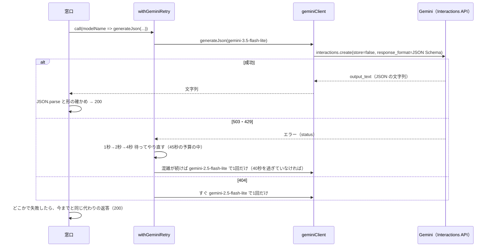

# Design Document: gemini-model-migration

## Overview

**Purpose**：AI の3つの機能（相談・時間割の生成・成績のリアクション）が使う Gemini のモデルと SDK を、提供が続くものに入れかえる。利用者から見た動き（画面に出る内容・形・口調・失敗したときの扱い）は変えない。
**Users**：利用者は画面4・5・7で今までどおり AI の機能を使う。作者は本番で動きを確かめる。
**Impact**：変わるのはサーバー側（`api/`）だけ。ブラウザ側（`src/`）・保存・Firestore のルールは変えない。

作者の決定（2026-11-13）：

| 決めること | 決定 |
|------|------|
| メインのモデル | `gemini-3.5-flash-lite` |
| 予備のモデル | `gemini-2.5-flash-lite` |
| 返答の JSON の受け取り方 | structured outputs（返す JSON の形を API 側で守らせる） |
| SDK の呼び方 | Interactions API（`store: false` を付ける） |

### Goals
- 3つの窓口が、新しいモデルで今までと同じ形・口調の返答を返す（1）
- 混雑・モデルが使えない・形が読み取れないときの動きを変えない（2）
- 認証・入力の確認・送る情報・チャットの窓口の停止を変えない（3）
- 使うモデルを、提供の終了日が発表されていないものにし、名前を1か所で管理する（4）
- 2026-12-01 より前に、確かめた版を本番に出す（5）

### Non-Goals
- AI のサービスを Gemini 以外に変えること、有料の枠にすること
- コマどり先輩のキャラクターや、返答に入れる内容そのものを変えること
- 会話の状態を Google 側で持つ機能（`previous_interaction_id`）を使うこと
- チャットの窓口を再び動かすこと

## Boundary Commitments

### This Spec Owns
- AI のモデル名（メイン・予備）と、その管理場所（`api/_lib/geminiRetry.ts`）
- Gemini を呼ぶ部品（新しい `api/_lib/geminiClient.ts`）と、SDK の依存（`package.json`）
- 3つの窓口が Gemini に渡す、返す JSON の形の定義（新しい `api/_lib/responseSchemas.ts`）
- 3つの窓口と、止めているチャットの窓口の、Gemini の呼び出し部分
- 新しいモデルで口調や形が崩れたときの、AI への指示（`systemInstruction`・プロンプト）の調整

### Out of Boundary
- 窓口の前処理（メソッド・認証・入力の確認・API キー）と、その応答（405・401・503・400・500）。`secure-and-stable` のまま変えない
- サーバーのシラバスからの科目の引き直し（`api/_lib/syllabus.ts`）
- ブラウザ側の呼び出し（`src/services/aiApi.ts`）と、送るプロフィールの項目
- 失敗したときに返す代わりの文面（`BUSY_MESSAGE`・`GENERAL_ERROR_MESSAGE`・各窓口の代わりの返答）の中身
- `vercel.json`（`maxDuration: 60`・`includeFiles`）

### Allowed Dependencies
- `@google/genai`（3.3 系）の `GoogleGenAI` と `interactions.create`
- 今の `withGeminiRetry`（やり直し・予備のモデルへの切りかえの流れ）。エラーの読み取りだけを新しい SDK に合わせる
- `api/_lib/http.ts`・`auth.ts`・`validation.ts`・`syllabus.ts`（変えずに使う）

### Revalidation Triggers
- モデル名を変えたとき：3つの窓口の返答の形と口調を、作者が本番で確かめ直す
- `responseSchemas.ts` の形を変えたとき：`src/services/aiApi.ts` のレスポンスの型と合っているかを確かめる
- Gemini API の Deprecations に、使っているモデルの終了日が出たとき：この spec と同じ手順でモデルを入れかえる

## Architecture

### Existing Architecture Analysis

```
ブラウザ（src/services/aiApi.ts）
  └─ POST /api/consultation | timetable-patterns | grade-reaction（ID トークン付き）
       └─ 前処理（認証・入力の確認・API キー）
       └─ プロンプトを組み立てる
       └─ withGeminiRetry(modelName => SDK でモデルを呼ぶ)   ← 今は @google/generative-ai の generateContent
       └─ 返答の文字列から JSON を取り出して JSON.parse（sanitizeJsonResponse。3ファイルに同じ関数）
       └─ 失敗したら 200 で代わりの返答
```

### Architecture Pattern & Boundary Map

```mermaid
graph TD
  Endpoint[api/consultation 等の窓口] --> Retry[withGeminiRetry]
  Retry --> Client[geminiClient.generateJson]
  Client --> SDK[@google/genai interactions.create]
  Endpoint --> Schemas[responseSchemas]
  Client --> Schemas
  Retry --> Status[getGeminiErrorStatus]
```

- 窓口は「どのプロンプトと、どの形の JSON がほしいか」だけを決める
- `geminiClient` は「SDK でモデルを1回呼んで、JSON の文字列を返す」だけを持つ。SDK を直接触るのはここだけ
- `withGeminiRetry` は「やり直しと予備への切りかえ」だけを持つ。モデル名もここで管理する（要件 4.2）

### Technology Stack

| 層 | 選んだもの | 役割 | 備考 |
|----|------|------|------|
| AI の SDK | `@google/genai` ^3.3.0 | Gemini の Interactions API を呼ぶ | `@google/generative-ai` は外す。Node.js 22 以上が必要（Vercel は 24.x） |
| モデル | `gemini-3.5-flash-lite`（メイン）、`gemini-2.5-flash-lite`（予備） | 文章の生成 | どちらも無料の枠があり、終了日の発表なし（2026-11-13） |
| 返答の形 | structured outputs（`response_format` の JSON Schema） | 決まった形の JSON を返させる | `minLength`・`maxLength` などは守られないので、文字数は今までどおり指示で伝える |

## File Structure Plan

### Directory Structure
```
api/
├── _lib/
│   ├── geminiClient.ts      # 新規：GoogleGenAI でモデルを1回呼び、JSON の文字列を返す（store: false、SDK のやり直しは切る）
│   ├── responseSchemas.ts   # 新規：3つの窓口が返させる JSON の形（JSON Schema）と、読み取った値の型の確かめ
│   └── geminiRetry.ts       # 変更：モデル名、エラーの status の読み取りを新しい SDK に合わせる
├── consultation.ts          # 変更：Gemini の呼び出しを geminiClient に、sanitizeJsonResponse を外す
├── timetable-patterns.ts    # 変更：同上
├── grade-reaction.ts        # 変更：同上
└── chatbot.ts               # 変更：新しい SDK に合わせる（今までどおり 410 を返す）
```

### Modified Files
- `package.json`・`package-lock.json`：`@google/generative-ai` を外し、`@google/genai` を足す
- `.kiro/steering/tech.md`：技術スタックの AI の行、API の共通パターン（SDK・モデル名・structured outputs・`store: false`・Node.js 22 以上）
- `.kiro/steering/structure.md`：`api/_lib/` のファイルの一覧
- `.kiro/specs/gemini-model-migration/production-check.md`（新規）：作者が本番で確かめる手順

## Steering Impact

| Steering file | Changes? | What changes | When it is updated |
|---------------|----------|--------------|--------------------|
| `tech.md` | Yes | AI の SDK・モデル名、API の共通パターン（JSON の受け取り方、やり直しの読み取り）、Node.js の版 | 実装のタスクの中 |
| `structure.md` | Yes | `api/_lib/` に2つのファイルが増える | 実装のタスクの中 |
| `product.md`・`data-model.md`・`deployment.md` | No | 利用者から見た動き・データの形・デプロイの手順は変わらない | — |
| `roadmap.md` | Yes | この spec を第2段階に足し、本番での確認のあとで完了にする | 最後のタスク |

## System Flows



## Requirements Traceability

| Requirement | Summary | Components | Notes |
|-------------|---------|------------|-------|
| 1.1 | 相談の講評とコメント | consultation、responseSchemas（consultation の形） | — |
| 1.2 | 5つのパターン | timetable-patterns、responseSchemas | パターンの名前と順番はプロンプトのまま |
| 1.3 | 称号とセリフ | grade-reaction、responseSchemas | — |
| 1.4 | 口調と文字数 | 3つの窓口の systemInstruction・プロンプト | 本番で作者が確かめる。崩れたら指示を調整 |
| 1.5 | ピン留めを守る | 変更なし（`resolveClassAssignments`、ブラウザ側） | 試しの画面で確かめる |
| 2.1–2.3 | やり直し・予備 | geminiRetry（`getGeminiErrorStatus`） | 時間と回数は変えない |
| 2.4 | 先輩の口調のエラー文 | geminiRetry（`getGeminiErrorMessage`） | 文面は変えない |
| 2.5 | 形が読み取れないとき | 3つの窓口の catch | JSON.parse・形の確かめが失敗したら代わりの返答 |
| 2.6 | 時間の上限 | geminiRetry の予算、geminiClient（SDK のやり直しを切る） | SDK が自分でやり直すと予算を超えるため |
| 3.1 | サーバー側だけ | geminiClient は `api/` の中だけ | — |
| 3.2 | 前処理で断る | 変更なし | — |
| 3.3 | 送る情報 | 変更なし（プロンプトに入れる項目は同じ）、`store: false` | — |
| 3.4 | チャットは断る | chatbot（410 のまま） | — |
| 4.1 | 終了日のないモデル | geminiRetry の定数 | 2026-11-13 の Deprecations で確認 |
| 4.2 | モデル名を1か所で | geminiRetry の `PRIMARY_MODEL`・`FALLBACK_MODEL` | — |
| 5.1–5.4 | 確かめて出す | ビルド・lint・試しの画面、production-check.md、steering | — |

## Components and Interfaces

### api/_lib

#### geminiClient

| Field | Detail |
|-------|--------|
| Intent | Interactions API でモデルを1回呼び、返答の JSON の文字列を返す |
| Requirements | 1.1–1.4, 2.6, 3.1, 3.3 |

**Responsibilities & Constraints**
- `GoogleGenAI({ apiKey })` の `interactions.create` を1回だけ呼ぶ。やり直しはしない（`withGeminiRetry` に任せる）
- 依頼には必ず `store: false` を付け、利用者のプロフィールや成績を Google 側に残さない
- SDK 自身のやり直しは切る（リクエストのオプションで最大のやり直しを 0 にする。オプションの名前は実装の最初に SDK の型で確かめる）
- 返答の文字列（`output_text`）が空なら、エラーを投げる

##### Service Interface
```typescript
export interface GenerateJsonParams {
  apiKey: string;
  model: string;
  systemInstruction: string;
  prompt: string;
  /** 返させる JSON の形（JSON Schema のオブジェクト） */
  responseSchema: Record<string, unknown>;
}

/** モデルを1回呼び、JSON の文字列を返す。失敗は SDK のエラーをそのまま投げる */
export function generateJson(params: GenerateJsonParams): Promise<string>;
```

#### geminiRetry（変更）

| Field | Detail |
|-------|--------|
| Intent | やり直しと予備のモデルへの切りかえ、モデル名の管理 |
| Requirements | 2.1–2.4, 2.6, 4.1, 4.2 |

- `PRIMARY_MODEL = "gemini-3.5-flash-lite"`、`FALLBACK_MODEL = "gemini-2.5-flash-lite"`
- エラーの判定を `GoogleGenerativeAIFetchError` から、新しい関数 `getGeminiErrorStatus` に置きかえる。やり直しの回数・待ち時間・時間の予算・404 のときの動きは変えない

```typescript
/**
 * SDK が投げたエラーから HTTP の status を読む。読めなければ undefined。
 * 新しい SDK はエラーの種類によって status を `status` または `statusCode` に持つので、両方を数値として確かめる（any を使わない）
 */
export function getGeminiErrorStatus(error: unknown): number | undefined;

export const isGeminiBusyError: (error: unknown) => boolean;          // 503・429
export function withGeminiRetry<T>(call: (modelName: string) => Promise<T>): Promise<T>;  // 形は今のまま
```

#### responseSchemas

| Field | Detail |
|-------|--------|
| Intent | 3つの窓口が返させる JSON の形と、読み取った値の型の確かめ |
| Requirements | 1.1–1.3, 2.5 |

```typescript
export const consultationSchema: Record<string, unknown>;      // { overallFeedback: string, courseFeedbacks: { courseId, courseName, comment }[] }
export const timetablePatternsSchema: Record<string, unknown>; // { patterns: { id, name, description, assignments: { courseId, classId }[] }[] }
export const gradeReactionSchema: Record<string, unknown>;     // { title: string, message: string }

/** JSON.parse したあとの値が形に合うかを確かめる型ガード（合わなければ代わりの返答にする） */
export function isConsultationResult(value: unknown): value is ConsultationResult;
export function isTimetablePatternsResult(value: unknown): value is TimetablePatternsResult;
export function isGradeReactionResult(value: unknown): value is GradeReactionResult;
```
- 形（項目の名前）は、今のプロンプトと `systemInstruction` に書いてある形、`src/services/aiApi.ts` のレスポンスの型と同じにする

### 窓口（consultation・timetable-patterns・grade-reaction）

- Gemini の呼び出しを `withGeminiRetry((model) => generateJson({ ..., model, responseSchema }))` に置きかえる
- `sanitizeJsonResponse` を外し、`JSON.parse` と型ガードで読む。どちらかが失敗したら、今までと同じ代わりの返答（200）
- プロンプトと `systemInstruction` の中身は変えない。ただし、新しいモデルで口調・文字数が崩れたときだけ調整する（作者の確認のあと）
- 書きかえる `catch (error: any)` は `unknown` にする

### chatbot（変更）

- 新しい SDK に合わせる（Interactions API、`store: false`、会話の履歴は依頼に含めて送る）。前処理で 410 を返す動きは変えない

## Error Handling

### Error Categories and Responses

| 起きること | 扱い（今と同じ） |
|------|------|
| 503・429（混雑） | 1秒→2秒→4秒 でやり直し → 予備のモデルで1回 → それでもだめなら「混雑している」先輩の文面 |
| 404（モデルが見つからない・終了） | すぐ予備のモデルで1回 → だめなら「調子が悪い」先輩の文面 |
| そのほかの API のエラー、返答が空 | やり直さない。「調子が悪い」先輩の文面 |
| JSON が読めない・形が違う | やり直さない。各窓口の代わりの返答 |

### Monitoring
- 今までどおり `console.warn`・`console.error` に、やり直しと予備への切りかえ、失敗の内容を残す（利用者の入力の中身は出さない）

## Testing Strategy

- **ビルドと lint**：`npm run build` が通る。lint の指摘が増えない（新しいコードに `any` を使わない）
- **試しの画面（`npm run check:ui`）**：AI 窓口は試しの画面の中で偽物の応答に差しかわるので、ブラウザ側の動き（AI の返答の表示、401・400・500 のときの扱い、ピン）が今までどおりかを確かめる（1.5、3.2）
- **サーバー側の部品の確認**：`getGeminiErrorStatus` が、新しい SDK のエラー（`status` を持つもの・`statusCode` を持つもの・どちらもないもの）で正しい値を返すこと。型ガードが、正しい形・項目が足りない形・型が違う形を見分けること。使い捨てのスクリプトで確かめる（テストの仕組みがないため）
- **本番での確認（作者）**：3つの機能を使い、返答の形と口調・文字数が今までどおりかを見る（1.1–1.4）。手順は `production-check.md` に書く。プレビューの URL では Google ログインができないので、本番か、作者のパソコンの `npm run dev`（`.env` に API キーがあるとき）で確かめる

## Security Considerations
- API キーは今までどおりサーバーの環境変数だけ（3.1）
- Interactions API は既定で依頼を Google 側に保存する（無料の枠は1日）。利用者のプロフィールや成績を残さないよう、すべての依頼に `store: false` を付ける（3.3）

## Migration Strategy
- 本番に出したあと、AI の機能がおかしければ、その commit を revert して前の版に戻す（2026-12-01 までは、前の版の `gemini-2.5-flash` も動く）
- 作者のパソコンで開発するときは、Node.js 22 以上が必要（`node -v` で確かめる）
