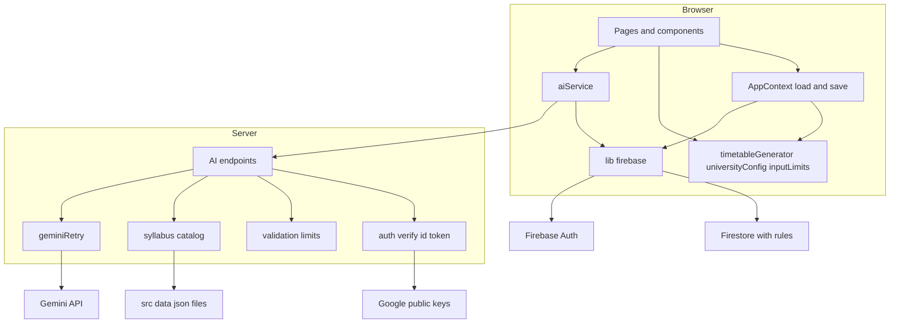
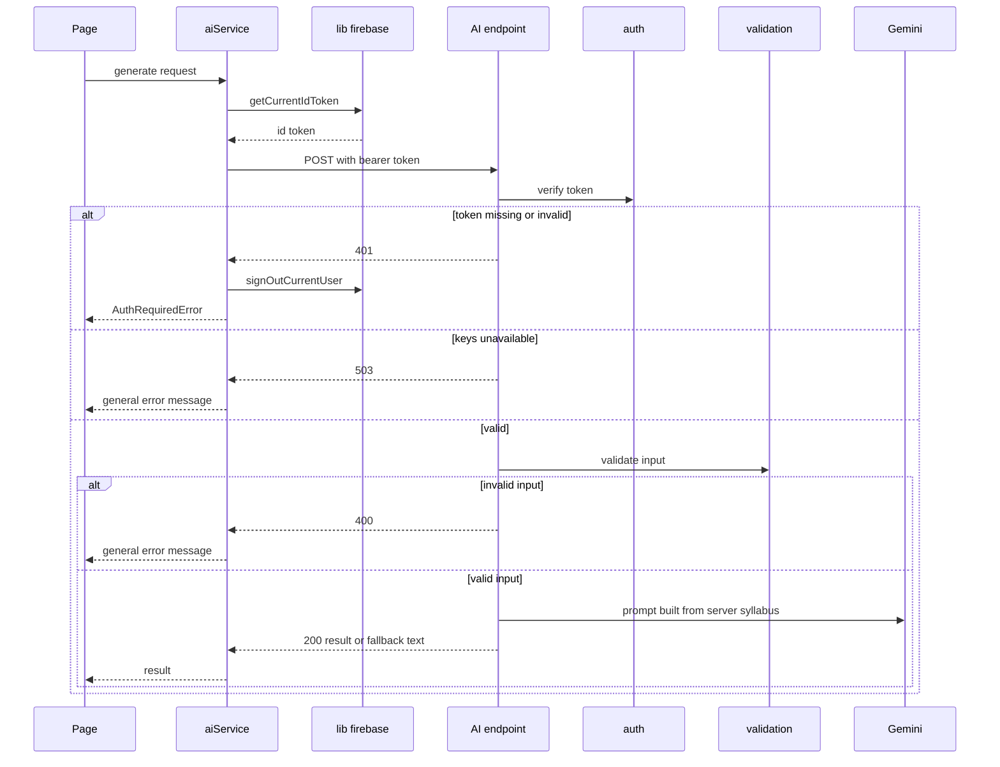
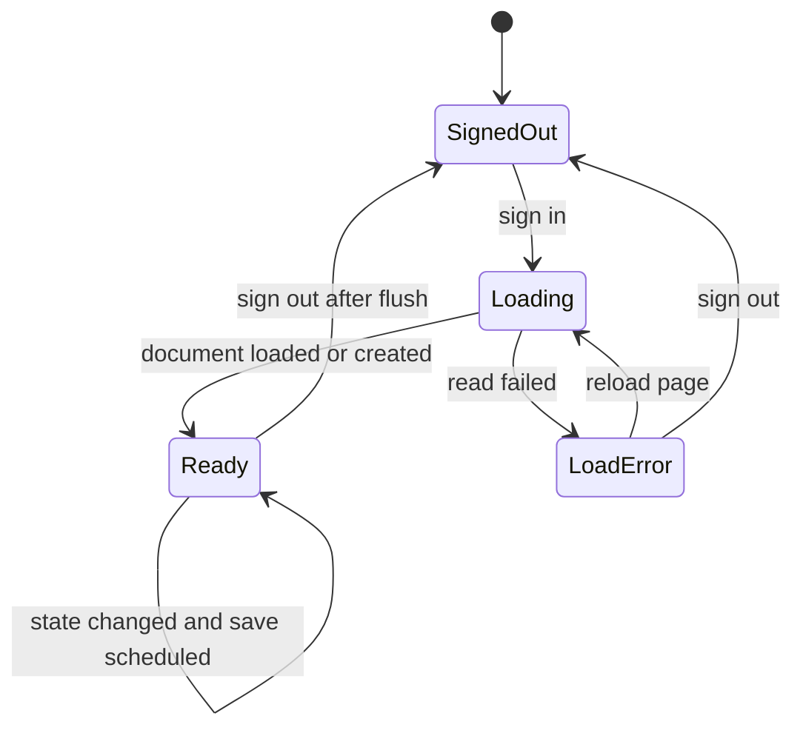

# Design Document: secure-and-stable

## Overview

**Purpose**：インターン先への提出（2026-10-29 ごろ）までに、コマどりを「第三者に AI の利用料を使われない」「保存データを本人以外が読み書きできない」「保存した時間割や成績が消えない・戻らない」「遅い時限の授業もピン留めも正しく反映される」状態にする。

**Users**：コマどりを使う学生（ログイン、時間割の作成、成績の入力）と、コマどりの作者（本番の運用、Firebase・Vercel の管理画面での反映）。

**Impact**：AI 窓口（`api/*`）の前に認証と入力の確認を足し、使われていないチャットの窓口を止める。ブラウザ側の保存の仕組みを「読み込み済みのときだけ・3秒まとめて・丸ごと」に変える。最大時限をプロフィールから変えられるようにし、ピン留めと合否の判定を1か所の関数に集める。フォルダ構成は変えない（移行は第2段階）。

### Goals
- 3つの AI 窓口は、ログイン中の本人の有効な ID トークンがないと AI を呼ばない。入力の上限と形を確かめ、AI に渡る科目の文章はサーバーのシラバスから引く
- 保存データは、読み込みが終わるまで書かない。消したものは保存データからも消える。1文字ごとに保存しない
- 最大時限を 5〜11 から選べ、遅い時限の授業とピン留めが正しく表示される。合否の判定がどこでも同じ
- 依存パッケージの重大・高の脆弱性が 0 件。本番の開発者ツールに設定の値やデバッグ用の文言が出ない

### Non-Goals
- 使い始める前に取った科目の登録（`course-history`）、フォルダ構成の移行、大学ごとの設定のデータ設計、シラバスの DB 化、空きコマ検索、画面の作り直し
- 1人あたりの AI 利用回数の制限、トークンの取り消しの確認
- チャットの画面を作ること、チャットの窓口の再開・削除
- 「曜日-時限」の形でないコマ（集中講義など）の表示の改善
- 選んだ科目を科目 ID だけで保存する形への変更
- AI のモデルの変更、テストの仕組みの導入

## Boundary Commitments

### This Spec Owns
- AI 窓口の前処理：ID トークンの検証、入力の上限と形の確認、上限の値（サーバー側の1か所）、エラー時の応答の形（401・400・410・503）
- AI 窓口がプロンプトに使う科目の中身を、サーバーのシラバスから引くこと
- チャットの窓口を止めること（コードは残す）
- ブラウザ側で ID トークンを付けて AI 窓口を呼ぶことと、401 のときにログアウトさせること
- Firestore のセキュリティルールのファイル（`firestore.rules`）と、反映・確認の手順
- 依存パッケージの更新（`npm audit fix` と `overrides`）と、本番に残るデバッグ用の `console.log` の削除
- 保存の流れ：読み込みの状態、読み込み前の書き込みの禁止、3秒まとめての保存、閉じるときの保存、`merge` なしの丸ごとの保存、利用者が変わったときの扱い
- 確定済みの授業の削除の完全一致、`startNewSemester` の合否
- 最大時限の選択肢（5〜大学の最後の時限）と、その変更の画面、表示範囲の外の授業の知らせ
- ピン留めの反映ルール（`resolveClassAssignments`）と、ピンを AI 窓口に伝えること
- 合否の判定の関数（2026-10-22 に作った `isCoursePassed`・`isCourseFailed`）を、残りの場所で使うこと
- 今の大学（会津大学）の設定の置き場所（`src/logic/universityConfig.ts`）と、ブラウザ側の入力の上限の置き場所（`src/logic/inputLimits.ts`）

### Out of Boundary
- 画面の見た目の作り直し（`ui-design-definition`・`first-run-ux-refresh`）。この spec で足す画面の部品は、今の画面の書き方に合わせた最小限のものにする
- フォルダの移動、`hooks/`・`services/`・`utils/` への切り出し（`src-structure-migration`）
- 大学ごとの設定の形と、それを保存・選ぶ仕組み（`university-data-model`）
- シラバス・口コミの読み込み先の変更（`syllabus-db`）
- ユーザーデータの形の変更（学期ごとの保存、科目 ID だけの保存）と、それに合わせた Firestore ルールの変更（`university-data-model`）
- 成績入力画面のアイコンと色（`GradeInputScreen` の `'D'`・`'F'`。表示であって合否の判定ではない）
- `/api/chatbot` の中身（止めるだけで、プロンプトなどは変えない）、`ReflectionScreen` などの未使用の機能

### Allowed Dependencies
- サーバー（`api/*`）：Node.js 標準の `crypto` と `fetch`、Google の公開鍵の URL、既存の `@google/generative-ai`、`src/data/*.json`（`fs` で読む。`src/` のコードは import しない）
- ブラウザ（`src/*`）：既存の `firebase`（Auth・Firestore）。`firebase/*` を import してよいのは `src/lib/firebase.ts` と `src/logic/AppContext.tsx` だけ（`src/ai/aiService.ts` は `src/lib/firebase.ts` を経由する）
- 新しいライブラリは入れない
- 依存の向き（ブラウザ）：`logic/universityConfig`・`logic/inputLimits`・`logic/types` → `logic/timetableGenerator` → `lib/firebase` → `ai/aiService`・`logic/AppContext` → `pages/*`・`components/*`。左にあるものは右にあるものを import しない
- 依存の向き（サーバー）：`api/_lib/http` → `api/_lib/syllabus`・`api/_lib/auth`・`api/_lib/validation`・`api/_lib/geminiRetry` → `api/*.ts`

### Revalidation Triggers
- AI 窓口のリクエスト・レスポンスの形（`Authorization` ヘッダー、`pinnedClasses`、エラーの形）を変えたとき → `src/ai/aiService.ts` と `data-model.md` を確かめ直す
- 入力の上限の値を変えたとき → `api/_lib/validation.ts` と `src/logic/inputLimits.ts` の両方をそろえる
- 保存データのドキュメントの場所や形を変えたとき（第2段階の学期ごとの保存）→ `firestore.rules` を直し、Rules Playground で確かめ直す
- `firebase` を更新したとき → `overrides` が要らなくなっていないか、`npm audit --omit=dev` を確かめ直す
- シラバスの読み込み先を変えたとき（`syllabus-db`）→ `api/_lib/syllabus.ts` の契約（ID で引ける）を保つ
- 大学ごとの設定を入れたとき（`university-data-model`）→ `src/logic/universityConfig.ts` を置きかえる

## Architecture

### Existing Architecture Analysis
- 画面 → `src/ai/aiService.ts` → `POST /api/*`（Vercel の Node.js 関数）→ Gemini。開発時は `vite.config.ts` の `local-api-handler` が同じ関数を呼ぶ
- AI 窓口は失敗時に 200 で代わりの文面を返す（`chatbot` だけ 500）。`api/_lib/geminiRetry.ts` で再試行と予備モデルを扱う
- 状態は `AppContext` が `AppState` 1つで持ち、`users/{uid}` の1ドキュメントに丸ごと保存する
- 守る既存の形：AI 窓口の成功時・Gemini 失敗時の応答（200 と代わりの文面）、`AppState` の形、画面の流れ（1〜8）、`firebase/*` を画面から import しない決まり

### Architecture Pattern & Boundary Map



**Architecture Integration**:
- 採用するパターン：今の構成のまま、AI 窓口の前に共通の前処理（認証 → 入力の確認）を挟む。ブラウザ側は、保存の入口を `AppContext` の1か所にまとめる
- 境界：サーバーの前処理は `api/_lib/` に、ブラウザの純粋な計算は `src/logic/` に、Firebase の呼び出しは `src/lib/firebase.ts` と `AppContext` に置く
- 守る既存のパターン：`api/_lib/` の共通処理（`_` で始まるのでエンドポイントにならない）、`.js` 付きの import、失敗時の 200 の代わりの文面、`ErrorBoundary`
- 新しい部品の理由：認証・入力の確認・シラバスの読み込みは3つの窓口で共通。ピンの反映と最後の時限の計算は複数の画面で共通
- steering との一致：計算はコード、文章だけ AI（`tech.md`）。秘密情報を `VITE_` に入れない。全国展開を前提に、大学ごとの値を1か所の設定から渡す（`product.md`）

### Technology Stack

| Layer | Choice / Version | Role in Feature | Notes |
|-------|------------------|-----------------|-------|
| Frontend | React 19.2・TypeScript・Vite（既存） | 保存の流れ、最大時限の画面、ピンの反映、ログアウト | 変更なし |
| Frontend | firebase 12.19（既存） | ID トークンの取得、ログアウト、Firestore の読み書き | `overrides` で `@grpc/grpc-js` を `^1.13.6` にする（ブラウザ用のビルドには入らない） |
| Backend | Vercel Node.js 関数（既存、Node 24） | AI 窓口 | `crypto`・`fetch` は Node.js 標準 |
| Backend | `@google/generative-ai` 0.24（既存） | Gemini の呼び出し | 変更なし |
| Data | Firestore（既存） | `users/{uid}` の保存データ | ルールの内容は変えず、リポジトリで管理する |
| Infrastructure | `vercel.json` | `maxDuration: 60`（既存）、`includeFiles: "src/data/**"`（追加） | サーバーがシラバスを確実に読めるようにする |

## File Structure Plan

### Directory Structure
```
api/
├── _lib/
│   ├── http.ts            # 新規：AI 窓口が使うリクエスト・レスポンスの最小限の型と、エラー応答の送り方
│   ├── auth.ts            # 新規：Firebase ID トークンの検証（公開鍵のキャッシュを含む）
│   ├── validation.ts      # 新規：入力の上限の値（INPUT_LIMITS）と、窓口ごとの入力の確認
│   ├── syllabus.ts        # 新規：src/data のシラバス・口コミ本文を読み、ID で科目を引く
│   └── geminiRetry.ts     # 既存（変更なし）
├── consultation.ts        # 変更
├── timetable-patterns.ts  # 変更
├── grade-reaction.ts      # 変更
└── chatbot.ts             # 変更（止める）
src/
├── logic/
│   ├── universityConfig.ts  # 新規：今の大学（会津大学）の設定。最後の時限・最大時限の下限
│   └── inputLimits.ts       # 新規：ブラウザ側の入力の上限（api/_lib/validation.ts の値と同じ）
firestore.rules              # 新規：Firestore のセキュリティルール（今の管理画面の内容と同じ）
```

### Modified Files
- `api/consultation.ts`・`api/timetable-patterns.ts`・`api/grade-reaction.ts` — 冒頭に「メソッド → 認証 → 入力の確認 → API キー」の順の前処理を足す。プロンプトに使う科目の中身を `syllabus.ts` から引く。`timetable-patterns` はピンをプロンプトに入れる。成功時と Gemini 失敗時の応答は変えない
- `api/chatbot.ts` — 冒頭で、メソッド・ログイン・内容にかかわらず 410 を返す。以降のコードは残す
- `src/lib/firebase.ts` — 設定の値を出す `console.log` を消す。`getCurrentIdToken`・`signOutCurrentUser` を足す
- `src/ai/aiService.ts` — 共通の `postToApi` で ID トークンを付けて呼ぶ。401 ならログアウトさせる。`generateTimetablePatterns` にピンを渡す
- `src/logic/AppContext.tsx` — 読み込みの状態、保存の予約（3秒・閉じるとき・ログアウトの前）、`merge` なしの保存、`removeCommittedClass` の完全一致、`startNewSemester` の合否を `isCoursePassed` に
- `src/logic/timetableGenerator.ts` — `isPassingGradePoint`・`resolveClassAssignments`・`getLatestPeriod` を足す（`isCoursePassed` は既存）
- `src/components/App.tsx` — 読み込みに失敗したときの画面を出す。デバッグ用の `console.log` を消す
- `src/pages/OnboardingScreen.tsx` — 最大時限の選択肢を `universityConfig` から作る。ニックネーム・職業の入力欄を 100 文字までにする
- `src/pages/DashboardScreen.tsx` — プロフィールに最大時限の選択を足す。ニックネーム・職業の入力欄を 100 文字までにする。表示範囲の外の授業を知らせる。GPA シミュレーターの合否を `isPassingGradePoint` に。デバッグ用の `console.log` を消す
- `src/pages/GeneratorScreen.tsx` — 割り当ての補い方を `resolveClassAssignments` に置きかえる（生成時とパターン切り替え時）。ピンを渡す。表示範囲の外の授業を知らせる。デバッグ用の `console.log` を消す
- `src/pages/CourseSelectionScreen.tsx` — 41 科目目を選ぼうとしたら選ばずに知らせる（カードのチェックと詳細モーダルの両方）
- `vercel.json` — `functions` の `api/*.ts` に `includeFiles: "src/data/**"` を足す
- `package.json`・`package-lock.json` — `npm audit fix` と `overrides`
- `.kiro/steering/data-model.md` — AI 窓口の認証・`pinnedClasses`・エラーの形・サーバーがシラバスから引くことを、**コードより先に**書く
- `.kiro/steering/structure.md`・`tech.md`・`deployment.md`・`product.md`・`roadmap.md` — 変わった仕様を、変更を入れるタスクの中で反映する（「Steering Impact」の表）

## Steering Impact

`.kiro/steering/` の全ファイル（2026-10-23 時点の6つ）について、この spec で変わるかを、設計の各節から決めた。更新は、その変更を入れるタスクの中で行う（最後にまとめて直さない）。

| Steering file | Changes? | What changes | When it is updated |
|---------------|----------|--------------|--------------------|
| `data-model.md` | Yes | AI 窓口の認証・`pinnedClasses`・エラーの形・410、科目の中身はサーバーのシラバスから引くこと、最大時限の範囲（5〜11）、保存の仕方（読み込み後だけ・丸ごと）（Data Contracts から） | タスク 1.1（コードより先） |
| `structure.md` | Yes | 今の構成に新しいファイルを足す：`api/_lib/http.ts`・`auth.ts`・`validation.ts`・`syllabus.ts`、`src/logic/universityConfig.ts`・`inputLimits.ts`、ルートの `firestore.rules`（File Structure Plan から） | 各ファイルを作るタスク（1.2・1.3・1.4・2.1・2.2） |
| `deployment.md` | Yes | Firestore のルールの反映と Rules Playground での確認の手順（3.5）。プロジェクト ID の環境変数の扱い（`FIREBASE_PROJECT_ID` があれば優先、なければ `VITE_FIREBASE_PROJECT_ID`） | ルールはタスク 1.4、環境変数はタスク 2.1 |
| `tech.md` | Yes | AI 窓口の共通パターン（メソッド → 認証 → 入力の確認 → API キー、410、`includeFiles`）、`overrides` の理由、既知の注意点（`merge: true`・読み込み前の書き込み・デバッグ用ログの記述を今の状態に） | 窓口のパターンはタスク 3.1、`includeFiles` はタスク 1.2、`overrides` はタスク 7.2、保存とログの注意点はタスク 5.2・7.1 |
| `product.md` | Yes | 最大時限をプロフィールで変えられる（5〜11）、チャットの窓口を止めた、科目は 40 まで、ログインが切れたらログイン画面に戻る、読み込みに失敗したときの画面 | 横断的なまとめとしてタスク 8.2 |
| `roadmap.md` | Yes | `university-data-model` への申し送り：学期ごとの保存（`users/{uid}/terms/...`）に合わせて Firestore のルールも直す | タスク 1.4 |

## System Flows

### AI 窓口の呼び出し



- 認証を入力の確認より先に行う。ログインしていない人には、入力のどこが違うかも返さない
- 503 は利用者をログアウトさせない（Google 側の障害で利用者を追い出さないため）

### 保存の流れ（`AppContext`）



- 保存の予約は `Ready` のときだけ作る。`Loading`・`LoadError` の間は、状態が変わっても保存しない（5.1・5.3）
- 予約は「利用者の uid と、その時点の状態」を持つ。最後の変更から 3 秒たったら `merge` なしで書く（6.1・6.2・7.1）
- ページが隠れる（`visibilitychange` の hidden）・閉じられる（`pagehide`）とき、ログアウトの前、別の利用者に切り替わる前は、予約をすぐ実行する（5.5・7.3）

## Requirements Traceability

| Requirement | Summary | Components | Interfaces | Flows |
|-------------|---------|------------|------------|-------|
| 1.1 | 依頼にログインの情報を添える | AiService, FirebaseLib | `postToApi`, `getCurrentIdToken` | AI 窓口の呼び出し |
| 1.2 | 有効なら今までどおり処理 | IdTokenVerifier, AI endpoints | `verifyIdToken` | AI 窓口の呼び出し |
| 1.3 | なし・無効なら AI を呼ばず断る | IdTokenVerifier, AI endpoints, ApiHttp | `verifyIdToken`, `sendError(401)` | AI 窓口の呼び出し |
| 1.4 | 3つの窓口すべてで確認 | AI endpoints | 各窓口の前処理 | — |
| 1.5 | 断られたらログアウトしてログイン画面 | AiService, FirebaseLib, App | `signOutCurrentUser`, `AuthRequiredError` | AI 窓口の呼び出し |
| 1.6 | ログインし直したら保存済みの状態 | AppContext | 読み込みの状態 | 保存の流れ |
| 2.1 | 科目・成績が 40 を超えたら断る | InputValidator | `INPUT_LIMITS`, `validate*Input` | — |
| 2.2 | ニックネーム・職業が 100 文字を超えたら断る | InputValidator | `validate*Input` | — |
| 2.3 | チャットの窓口は断る | Chatbot endpoint | 410 | — |
| 2.4 | 必要な項目がない・種類が違うなら断る | InputValidator, SyllabusCatalog | `validate*Input`, `getCourse` | — |
| 2.5 | 断られたら先輩の口調のエラー | AiService | `API_ERROR_MESSAGE` | AI 窓口の呼び出し |
| 2.6 | 入力欄は 100 文字まで | OnboardingScreen, DashboardScreen, InputLimits | `PROFILE_TEXT_MAX_LENGTH` | — |
| 2.7 | 41 科目目は選べない | CourseSelectionScreen, InputLimits | `MAX_SELECTED_COURSES` | — |
| 2.8 | 上限の値は1か所 | InputValidator | `INPUT_LIMITS` | — |
| 3.1 | 本人のデータだけ読み書き | FirestoreRules | `firestore.rules` | — |
| 3.2 | 他人・未ログインは拒否 | FirestoreRules | `firestore.rules` | — |
| 3.3 | ほかの場所は拒否 | FirestoreRules | `firestore.rules` | — |
| 3.4 | 決まりをリポジトリで管理 | FirestoreRules | `firestore.rules` | — |
| 3.5 | 反映と確認の手順を残す | Deployment docs | `deployment.md` | — |
| 4.1 | 重大・高の脆弱性 0 件 | Dependency update | `package.json` の `overrides` | — |
| 4.2 | 解消できないものは理由を記録 | Dependency update | `tech.md` | — |
| 4.3 | 更新で動きを変えない | Dependency update | 共通の確認 | — |
| 4.4 | 本番に設定の値・デバッグ用の文言を出さない | FirebaseLib, App, GeneratorScreen, DashboardScreen | `console.log` の削除 | — |
| 4.5 | 想定外のエラーは出す | 全体 | `console.error`・`console.warn` を残す | — |
| 5.1 | 読み込み終わるまで書かない | AppContext | `loadStatus`, `SaveScheduler` | 保存の流れ |
| 5.2 | 読み込み後に保存済みの状態を表示 | AppContext | 読み込み | 保存の流れ |
| 5.3 | 読み込み失敗なら上書きせず伝える | AppContext, App | `loadStatus = 'error'` | 保存の流れ |
| 5.4 | 初めての利用者はオンボーディング | AppContext | 初期状態での作成 | 保存の流れ |
| 5.5 | 前の利用者の状態を後の利用者に書かない | AppContext | 予約の uid | 保存の流れ |
| 6.1 | 解除したピンが戻らない | AppContext | `merge` なしの保存 | 保存の流れ |
| 6.2 | 新学期でリセットしたものが戻らない | AppContext | `merge` なしの保存 | 保存の流れ |
| 6.3 | 削除は完全一致 | AppContext | `removeCommittedClass` | — |
| 6.4 | 再読み込み後も同じ | AppContext | `merge` なしの保存 | 保存の流れ |
| 7.1 | 入力が止まって 3 秒以内にまとめて保存 | AppContext | `SAVE_DEBOUNCE_MS` | 保存の流れ |
| 7.2 | 保存後の再読み込みで表示 | AppContext | 読み込み | 保存の流れ |
| 7.3 | 閉じるとき・再読み込みのときに保存を試みる | AppContext | `flush` | 保存の流れ |
| 7.4 | 保存に失敗しても止めない | AppContext | `flush` のエラー処理 | — |
| 8.1 | プロフィールで最大時限を変えられる | DashboardScreen | `updateSettings` | — |
| 8.2 | 5〜大学の最後の時限 | UniversityConfig | `getSelectablePeriods` | — |
| 8.3 | オンボーディングも同じ範囲 | OnboardingScreen, UniversityConfig | `getSelectablePeriods` | — |
| 8.4 | 変えたら3つの表示を更新 | GeneratorScreen, DashboardScreen, MobileTimetableList | `timetableSettings.maxPeriods` | — |
| 8.5 | 再読み込み後も保つ | AppContext | 保存 | 保存の流れ |
| 8.6 | 6 限より後も同じように表示・重なりも表示 | GeneratorScreen, DashboardScreen | 既存のセル探し | — |
| 8.7 | 範囲の外の授業を知らせる | GeneratorScreen, DashboardScreen, Timetable logic | `getLatestPeriod` | — |
| 9.1 | ピンを AI 窓口に伝える | AiService, Timetable patterns endpoint | `pinnedClasses` | AI 窓口の呼び出し |
| 9.2 | すべてのパターンでピンを守る | GeneratorScreen, Timetable logic | `resolveClassAssignments` | — |
| 9.3 | 違うクラスならピンに置きかえる | Timetable logic | `resolveClassAssignments` | — |
| 9.4 | 代わりの時間割でも守る | GeneratorScreen, Timetable logic | `resolveClassAssignments` | — |
| 9.5 | 開講クラスにないピンは使わない | Timetable logic, InputValidator | `resolveClassAssignments`, `validateTimetablePatternsInput` | — |
| 9.6 | 手で変えたら利用者の選択を使う | GeneratorScreen | `handleAssignmentChange`（既存） | — |
| 10.1 | ポイントだけで判定 | Timetable logic | `isPassingGradePoint`, `isCoursePassed` | — |
| 10.2 | 新学期で合格した科目だけ修得済みに | AppContext | `startNewSemester` | — |
| 10.3 | どこでも同じ判定 | CourseSelectionScreen, AppContext, DashboardScreen | `isCoursePassed`, `isPassingGradePoint` | — |
| 10.4 | 段階にない名前は未入力と同じ | Timetable logic | `isCoursePassed`, `isCourseFailed` | — |
| 10.5 | 修得済みと不合格の両方なら合格 | Timetable logic | `isCoursePassed` | — |

## Components and Interfaces

| Component | Domain/Layer | Intent | Req Coverage | Key Dependencies | Contracts |
|-----------|--------------|--------|--------------|------------------|-----------|
| ApiHttp | Server / shared | 窓口の最小限の型とエラー応答 | 1.3, 2.1, 2.2, 2.3, 2.4 | — | Service |
| IdTokenVerifier | Server / auth | ID トークンの検証 | 1.2, 1.3, 1.4 | Google の公開鍵 (P0) | Service |
| InputValidator | Server / validation | 上限の値と入力の確認 | 2.1, 2.2, 2.4, 2.8, 9.5 | SyllabusCatalog (P0) | Service |
| SyllabusCatalog | Server / data | ID で科目を引く | 2.4 | `src/data/*.json` (P0) | Service |
| AI endpoints | Server / API | 3つの窓口の前処理と処理 | 1.2, 1.3, 1.4, 9.1 | 上の4つ (P0), geminiRetry (P0) | API |
| Chatbot endpoint | Server / API | チャットの窓口を止める | 2.3 | — | API |
| FirebaseLib | Browser / lib | トークンの取得とログアウト | 1.1, 1.5, 4.4 | firebase Auth (P0) | Service |
| AiService | Browser / client | 窓口の呼び出しと 401 の扱い | 1.1, 1.5, 2.5, 9.1 | FirebaseLib (P0) | Service |
| AppContext | Browser / state | 読み込みと保存の流れ、状態の更新 | 1.6, 5.x, 6.x, 7.x, 8.5, 10.2 | FirebaseLib (P0), Timetable logic (P1) | State |
| Timetable logic | Browser / logic | 合否・ピン・最後の時限の計算 | 8.7, 9.2〜9.5, 10.1, 10.3〜10.5 | UniversityConfig (P2) | Service |
| UniversityConfig | Browser / logic | 今の大学の設定 | 8.2, 8.3 | — | Service |
| InputLimits | Browser / logic | ブラウザ側の入力の上限 | 2.6, 2.7 | — | Service |
| FirestoreRules | Data / rules | 本人だけが読み書きできる | 3.1〜3.4 | Firestore (P0) | — |
| 画面（App・Onboarding・CourseSelection・Generator・Dashboard・MobileTimetableList） | Browser / UI | 上の部品を使う最小限の画面の変更 | 1.5, 2.6, 2.7, 4.4, 5.3, 8.1, 8.3, 8.4, 8.6, 8.7, 9.2, 9.4, 9.6, 10.3 | AppContext, Timetable logic | — |
| Dependency update | Build | 脆弱性の解消 | 4.1〜4.3 | npm | — |

### Server / shared

#### ApiHttp（`api/_lib/http.ts`）

| Field | Detail |
|-------|--------|
| Intent | AI 窓口が使うリクエスト・レスポンスの最小限の型と、エラー応答の形をそろえる |
| Requirements | 1.3, 2.1, 2.2, 2.3, 2.4 |

**Responsibilities & Constraints**
- Vercel と開発時の `local-api-handler` の両方で使える、最小限の型だけを定める（`any` を使わない）
- エラー応答の本文の形を1つにそろえる

**Contracts**: Service [x]

##### Service Interface
```typescript
export interface ApiRequest {
  method?: string;
  headers: Record<string, string | string[] | undefined>;
  body?: unknown;
}

export interface ApiResponse {
  status(code: number): ApiResponse;
  json(body: unknown): unknown;
}

export type ApiErrorCode =
  | 'method_not_allowed'   // 405
  | 'invalid_input'        // 400
  | 'unauthenticated'      // 401
  | 'chatbot_disabled'     // 410
  | 'server_misconfigured' // 500（API キー・プロジェクト ID・シラバスが読めない）
  | 'auth_unavailable';    // 503（公開鍵が取れない）

export function sendError(res: ApiResponse, status: number, code: ApiErrorCode): unknown;
```
- Postconditions：本文は `{ error: ApiErrorCode }` だけ。入力のどこが違うかなどの詳しい理由は返さず、サーバーのログにだけ残す

### Server / auth

#### IdTokenVerifier（`api/_lib/auth.ts`）

| Field | Detail |
|-------|--------|
| Intent | `Authorization: Bearer <ID トークン>` を Firebase の公式手順どおりに検証する |
| Requirements | 1.2, 1.3, 1.4 |

**Responsibilities & Constraints**
- ヘッダー：`alg` が `RS256`、`kid` が公開鍵のどれかと一致
- 中身：`exp` が未来、`iat` と `auth_time` が過去、`aud` がプロジェクト ID、`iss` が `https://securetoken.google.com/<プロジェクトID>`、`sub` が空でない文字列。時刻のずれは 60 秒まで許す
- 署名：Node.js 標準の `crypto` で、`kid` の公開鍵を使って RS256 を検証する
- 公開鍵は `https://www.googleapis.com/robot/v1/metadata/x509/securetoken@system.gserviceaccount.com` から取り、応答の `Cache-Control` の `max-age` の間、関数のメモリにキャッシュする。`kid` が見つからないときは1回だけ取り直す
- プロジェクト ID は `process.env.FIREBASE_PROJECT_ID ?? process.env.VITE_FIREBASE_PROJECT_ID`。どちらもなければ検証しない（`misconfigured`）
- トークンの取り消しは確かめない（Non-Goals）

**Dependencies**
- External: Google の公開鍵の URL — 署名の検証 (P0)
- External: Node.js `crypto`・`fetch` — 検証と取得 (P0)

**Contracts**: Service [x]

##### Service Interface
```typescript
export type AuthResult =
  | { ok: true; uid: string }
  | { ok: false; reason: 'missing' | 'malformed' | 'invalid_signature' | 'expired' | 'wrong_project' }
  | { ok: false; reason: 'keys_unavailable' | 'misconfigured' };

export function verifyIdToken(authorizationHeader: string | string[] | undefined): Promise<AuthResult>;
```
- Postconditions：`ok: true` のときだけ `uid` が入る。`missing`〜`wrong_project` は窓口が 401、`keys_unavailable` は 503、`misconfigured` は 500 にする
- Invariants：例外を外に投げない（すべて `AuthResult` で返す）

**Implementation Notes**
- Validation：不正な形・期限切れ・別プロジェクトのトークン・署名の改ざんで 401 になることを確かめる
- Risks：公開鍵の取得が失敗し続けると AI 機能が使えなくなる → 503 にして、利用者はログアウトさせない

### Server / validation

#### InputValidator（`api/_lib/validation.ts`）

| Field | Detail |
|-------|--------|
| Intent | 入力の上限の値を1か所に持ち、窓口ごとに入力の形を確かめて、AI に渡す値を作る |
| Requirements | 2.1, 2.2, 2.4, 2.8, 9.5 |

**Responsibilities & Constraints**
- 上限の値は `INPUT_LIMITS` だけに書く（2.8）
- 科目は `id_name` だけを信じ、`SyllabusCatalog` で引けない ID があれば `invalid_input`。同じ ID が重なっていれば1つにまとめる
- ピンは、送られた科目にない・その科目の開講クラスにないものを捨てる（400 にはしない。古いピンは普通に起こるため。9.5）
- 確認に通った値は、サーバーのシラバスの中身で組み立て直して返す

**Dependencies**
- Outbound: SyllabusCatalog — ID で科目を引く (P0)

**Contracts**: Service [x]

##### Service Interface
```typescript
export const INPUT_LIMITS = {
  maxCourses: 40,          // 2.1
  maxGrades: 40,           // 2.1
  maxProfileText: 100,     // 2.2（nickname・dreamJob・university）
  maxIdLength: 200,        // 科目 ID
  maxShortText: 50,        // クラス ID・ベースクラス・成績の名前
  maxGradingScaleEntries: 20,
} as const;

export type ValidationResult<T> = { ok: true; value: T } | { ok: false; issue: string };

export interface ProfileInput { nickname: string; dreamJob: string; university: string }
export interface GradingScaleEntry { label: string; point: number }

export interface ConsultationInput {
  profile: ProfileInput;
  courses: CatalogCourse[];             // サーバーのシラバスから引いた科目
}
export interface TimetablePatternsInput {
  courses: CatalogCourse[];
  baseClass: string;
  pinnedClasses: Record<string, string>; // 開講クラスにあるものだけ（9.5）
}
export interface GradeReactionInput {
  profile: ProfileInput;
  gradingScale: GradingScaleEntry[];
  grades: { course: CatalogCourse; grade: string }[]; // 成績が空でないものだけ
}

export function validateConsultationInput(body: unknown): ValidationResult<ConsultationInput>;
export function validateTimetablePatternsInput(body: unknown): ValidationResult<TimetablePatternsInput>;
export function validateGradeReactionInput(body: unknown): ValidationResult<GradeReactionInput>;
```
- 入力の形（`data-model.md` の各 Request と互換）
  - `consultation`：`{ userProfile: { nickname, dreamJob, university? }, courses: { id_name }[] }`
  - `timetable-patterns`：`{ courses: { id_name }[], baseClass?: string, pinnedClasses?: Record<string, string> }`
  - `grade-reaction`：`{ userProfile: { nickname?, dreamJob?, university?, gradingScale: { label, point }[] }, grades: { courseId, grade }[] }`（`courseName`・`credits` は送られても使わず、シラバスから引く）
- Preconditions：`body` は JSON を解析済みの値（形は不明）
- Postconditions：`ok: false` なら AI を呼ばない。`issue` はサーバーのログ用で、応答には含めない
- Invariants：文字数は JavaScript の文字列の長さで数える。数は有限の数だけ受け付ける。成績のポイントは 0 以上

### Server / data

#### SyllabusCatalog（`api/_lib/syllabus.ts`）

| Field | Detail |
|-------|--------|
| Intent | `src/data/syllabus.json` と `reviews_text.json` を読み、科目 ID で引けるようにする |
| Requirements | 2.4 |

**Responsibilities & Constraints**
- 関数のメモリに1回だけ読み込む。読めないときは例外を投げ、窓口が `server_misconfigured`（500）にする（空のまま黙って進めない）
- `fs` で読む（`api/` は `src/` のコードを import しない決まり）。`vercel.json` の `includeFiles` で同梱する

**Contracts**: Service [x]

##### Service Interface
```typescript
export interface CatalogClass { classId: string; schedule: string[] }
export interface CatalogCourse {
  id: string;            // id_name
  credits: number;
  outline: string;
  reviewComment?: string; // reviews_text.json の本文
  classes: CatalogClass[]; // class_id と schedule がそろっているものだけ
}

export class SyllabusUnavailableError extends Error {}

export function getCourse(id: string): CatalogCourse | undefined; // 読めないときは SyllabusUnavailableError
```

### Server / API

#### AI endpoints（`api/consultation.ts`・`api/timetable-patterns.ts`・`api/grade-reaction.ts`）

| Field | Detail |
|-------|--------|
| Intent | 前処理（メソッド → 認証 → 入力の確認 → API キー）を通った依頼だけを、これまでどおり処理する |
| Requirements | 1.2, 1.3, 1.4, 9.1 |

**Responsibilities & Constraints**
- 成功時と Gemini 失敗時の応答（200 と代わりの文面）は変えない。プロンプトの言い回しとコマどり先輩のキャラ付けも変えない
- プロンプトに入れる科目の中身（概要・口コミ・クラスとコマ・単位）は `InputValidator` が返した値（サーバーのシラバス）から作る
- `timetable-patterns` は、ピンを「この科目はこのクラスを必ず選ぶ」としてプロンプトに入れる。返った結果をサーバーで直すことはしない（ブラウザの `resolveClassAssignments` が守る）
- 応答を返した後に Gemini を呼ぶことはない（401・400・410・503・500 のときは Gemini を呼ばない）

**Contracts**: API [x]

##### API Contract
| Method | Endpoint | Request | Response | Errors |
|--------|----------|---------|----------|--------|
| POST | /api/consultation | `Authorization: Bearer <ID トークン>`＋`ConsultationRequest` | `ConsultationResponse`（失敗時も 200 で代わりの文面） | 400, 401, 405, 500, 503 |
| POST | /api/timetable-patterns | 同上＋`TimetablePatternsRequest`（`pinnedClasses` を追加） | `TimetablePatternsResponse`（同上） | 400, 401, 405, 500, 503 |
| POST | /api/grade-reaction | 同上＋`GradeReactionRequest` | `GradeReactionResponse`（同上） | 400, 401, 405, 500, 503 |

#### Chatbot endpoint（`api/chatbot.ts`）

| Field | Detail |
|-------|--------|
| Intent | チャットの窓口を止める |
| Requirements | 2.3 |

**Contracts**: API [x]

##### API Contract
| Method | Endpoint | Request | Response | Errors |
|--------|----------|---------|----------|--------|
| すべて | /api/chatbot | 何でも | — | 410 `{ error: 'chatbot_disabled' }` |

**Implementation Notes**
- ハンドラーの最初で `CHATBOT_ENABLED`（`false`）を見て 410 を返す。ログイン・メソッド・本文は見ない。以降のコードは消さない（再開するかは後で決める）

### Browser / lib・client

#### FirebaseLib（`src/lib/firebase.ts`）

| Field | Detail |
|-------|--------|
| Intent | ID トークンの取得とログアウトを、`firebase/*` を直接 import できない部品に提供する |
| Requirements | 1.1, 1.5, 4.4 |

**Contracts**: Service [x]

##### Service Interface
```typescript
export function getCurrentIdToken(): Promise<string | null>; // ログインしていなければ null。期限が近ければ firebase が更新する
export function signOutCurrentUser(): Promise<void>;
```
- 設定の値（API キーの先頭・認証ドメイン・プロジェクト ID）を出す `console.log` を消す（4.4）

#### AiService（`src/ai/aiService.ts`）

| Field | Detail |
|-------|--------|
| Intent | ID トークンを付けて AI 窓口を呼び、結果とエラーを画面に返す |
| Requirements | 1.1, 1.5, 2.5, 9.1 |

**Responsibilities & Constraints**
- 3つの関数は共通の `postToApi` を使う
- 401 なら `signOutCurrentUser` を呼んでから `AuthRequiredError` を投げる。ログアウトで `onAuthStateChanged` が動き、ログイン画面が出る（1.5）
- 400・410・500・503・通信の失敗は、これまでと同じ `API_ERROR_MESSAGE` の `Error` を投げる（2.5）
- トークンが取れない（ログインしていない）ときは、呼ばずに `AuthRequiredError` を投げる

**Contracts**: Service [x]

##### Service Interface
```typescript
export class AuthRequiredError extends Error {}

export const generateConsultation: (
  userProfile: AppState['userProfile'], courses: CourseData[]
) => Promise<ConsultationResponse>;

export const generateTimetablePatterns: (
  courses: CourseData[], baseClass: string, pinnedClasses: AppState['pinnedClasses']
) => Promise<TimetablePatternsResponse>;

export const generateGradeReaction: (
  userProfile: AppState['userProfile'], grades: GradeInput[]
) => Promise<GradeReactionResponse>;
```

### Browser / state

#### AppContext（`src/logic/AppContext.tsx`）

| Field | Detail |
|-------|--------|
| Intent | 保存データの読み込みと保存の流れを1か所で守り、状態の更新関数を提供する |
| Requirements | 1.6, 5.1, 5.2, 5.3, 5.4, 5.5, 6.1, 6.2, 6.3, 6.4, 7.1, 7.2, 7.3, 7.4, 8.5, 10.2 |

**Responsibilities & Constraints**
- `loadStatus`：`'signedOut' | 'loading' | 'ready' | 'error'`。`onAuthStateChanged` で利用者が変わったら、まず前の利用者の保存の予約をすぐ実行し、次に状態を `defaultState` に戻して `loading` にしてから読み込む
- 読み込み：ドキュメントがあれば今までどおり `defaultState` に重ねる（`userProfile`・`timetableSettings`・`timetableConditions` は1段深く重ねる）。なければ `defaultState` で作る。どちらも終わったら `ready`。失敗したら `error`（上書きしない）
- 保存：`ready` のときだけ、状態の変化ごとに予約を作り直す。予約は `{ uid, state }` を持ち、最後の変化から `SAVE_DEBOUNCE_MS = 3000` 後に `setDoc(users/{uid}, state)` を `merge` なしで実行する
- すぐ実行する場面：`visibilitychange` で hidden になったとき、`pagehide`、`logout` の前、利用者が切り替わる前
- 保存の失敗：`console.error` に記録し、画面は止めない。同期的な例外も `try/catch` で受け止める（2026-10-11 の修正を保つ）
- `authLoading` は今までどおり公開し、`loading` の間は `true` にする（画面は読み込みが終わるまで出ない）
- `removeCommittedClass(courseId, classId)`：`committedClasses` は `courseId` と `classId` が両方一致するものだけ、`selectedCourses` は `id_name === courseId` のものだけを除く（6.3）
- `startNewSemester`：修得済みに加えるのは `isCoursePassed(courseId, grades, earnedCredits, gradingScale)` が `true` の科目だけ（10.2）。`'F'`・`'D'`・`'不可'` の直書きをなくす

**Contracts**: State [x]

##### State Management
```typescript
type LoadStatus = 'signedOut' | 'loading' | 'ready' | 'error';

interface AppContextType {
  // 既存のものはそのまま
  loadStatus: LoadStatus; // 追加。App が 'error' のときに読み込み失敗の画面を出す（5.3）
}
```
- Persistence & consistency：`users/{uid}` のドキュメントは、読み込み後の `AppState` そのもの（`merge` なし）。`ignoreUndefinedProperties` は今までどおり
- Concurrency strategy：同じ利用者の複数のタブは、後から保存したほうが勝つ（今と同じ。範囲外）

**Implementation Notes**
- Integration：保存の予約と「すぐ実行」は `AppContext` の中の小さな仕組みにする。`hooks/` への切り出しは第2段階の移行で行う
- Validation：ログイン直後に保存が走らないこと、ピン解除・新学期のリセットが再読み込みで戻らないこと、連続入力で保存が1回になることを確かめる
- Risks：読み込み前に保存が走ると `merge` なしなので全部消える → `ready` のときだけ予約する。利用者の切り替えでは、予約に入っている uid の分だけを書く

### Browser / logic

#### Timetable logic（`src/logic/timetableGenerator.ts` に追加）

| Field | Detail |
|-------|--------|
| Intent | 合否・ピンの反映・最後の時限を、画面に依存しない関数で計算する |
| Requirements | 8.7, 9.2, 9.3, 9.4, 9.5, 10.1, 10.3, 10.4, 10.5 |

**Contracts**: Service [x]

##### Service Interface
```typescript
/** ポイントが合格か（0 は不合格、0 より大きければ合格）。10.1 */
export function isPassingGradePoint(point: number): boolean;

/** 既存（2026-10-22）。isPassingGradePoint を使うようにする。10.4・10.5 は今の動きのまま */
export function isCoursePassed(
  courseId: string, userGrades: AppState['grades'],
  earnedCredits: AppState['earnedCredits'], gradingScale: AppState['userProfile']['gradingScale']
): boolean;

/**
 * 科目ごとのクラスを決める。優先順位：
 * 1. 有効なピン（その科目の開講クラスにあるとき）
 * 2. パターンの割り当て（その科目の開講クラスにあるとき）
 * 3. 最初のクラス（なければ空文字）
 */
export function resolveClassAssignments(
  courses: CourseData[],
  patternAssignments: { courseId: string; classId: string }[],
  pinnedClasses: AppState['pinnedClasses']
): Record<string, string>;

/** 「曜日-時限」の形のコマのうち、いちばん遅い時限。なければ 0。8.7 */
export function getLatestPeriod(schedules: TimeSlot[][]): number;
```
- Postconditions（`resolveClassAssignments`）：すべての科目にキーがある。有効なピンがある科目は必ずそのクラス（9.2・9.3・9.4）。無効なピンは使われない（9.5）
- 呼び出し側：`GeneratorScreen` の生成時（AI の結果・代わりの時間割の両方）とパターン切り替え時。生成後に利用者が手で変えたクラスは、そのパターンを表示している間そのまま使う（9.6。既存の `handleAssignmentChange`）

#### UniversityConfig（`src/logic/universityConfig.ts`）

| Field | Detail |
|-------|--------|
| Intent | 今の大学（会津大学）の、大学ごとに変わる値を1か所に置く |
| Requirements | 8.2, 8.3 |

**Contracts**: Service [x]

##### Service Interface
```typescript
export interface UniversityConfig {
  name: string;               // '会津大学'
  lastPeriod: number;         // 11
  minSelectablePeriod: number; // 5
}

export const CURRENT_UNIVERSITY: UniversityConfig;

/** 最大時限の選択肢（minSelectablePeriod 〜 lastPeriod） */
export function getSelectablePeriods(config?: UniversityConfig): number[];
```
- 第2段階の `university-data-model` で、大学ごとの設定に置きかえる

#### InputLimits（`src/logic/inputLimits.ts`）

| Field | Detail |
|-------|--------|
| Intent | ブラウザ側の入力の上限 |
| Requirements | 2.6, 2.7 |

```typescript
export const MAX_SELECTED_COURSES = 40;      // api/_lib/validation.ts の INPUT_LIMITS.maxCourses と同じ
export const PROFILE_TEXT_MAX_LENGTH = 100;  // 同 maxProfileText
```
- `api/` と `src/` は互いに import しない決まりのため、値を2か所に書く。コメントで相手の場所を示す（`API_ERROR_MESSAGE` と同じやり方）

### Browser / UI（最小限の変更。見た目の作り直しはしない）

| 画面 | 変更 | Requirements |
|------|------|--------------|
| `App.tsx`（AuthGate） | `loadStatus === 'error'` のとき、コマどり先輩の口調で「保存データを読み込めなかった」と出し、「再読み込み」ボタン（ページの再読み込み）を出す。ログアウトの `console.log` を消す | 1.5, 4.4, 5.3 |
| `OnboardingScreen.tsx` | 最大時限の選択肢を `getSelectablePeriods()` から作る。ニックネーム・職業の入力欄に `maxLength={PROFILE_TEXT_MAX_LENGTH}` | 2.6, 8.3 |
| `DashboardScreen.tsx` | プロフィールの編集で最大時限を選べるようにする（「保存する」で `updateSettings`）。入力欄に `maxLength`。時間割のタブで、`getLatestPeriod(確定した授業のコマ) > maxPeriods` なら「N限の授業が表示の範囲（M限まで）の外にあります。プロフィールで最大時限を変えられます」と出す。GPA シミュレーターの合否を `isPassingGradePoint` に。ログアウトの `console.log` を消す | 2.6, 4.4, 8.1, 8.4, 8.6, 8.7, 10.3 |
| `GeneratorScreen.tsx` | 生成時とパターン切り替え時の補う処理を `resolveClassAssignments` に置きかえる。`generateTimetablePatterns` にピンを渡す。プレビューで表示の範囲の外の授業があれば同じ文言で知らせる。「送る科目データ」の `console.log` を消す | 4.4, 8.4, 8.6, 8.7, 9.1, 9.2, 9.4, 9.6 |
| `CourseSelectionScreen.tsx` | まだ選んでいない科目を選ぼうとして、すでに `MAX_SELECTED_COURSES` 科目あるときは、選ばずに「一度に選べるのは 40 科目までです」と知らせる（カードのチェックと詳細モーダルの両方） | 2.7, 10.3 |
| `MobileTimetableList.tsx` | 変更なし（`periods` を親から受け取るので、8.4 は親の変更で満たす） | 8.4 |

## Data Models

### Domain Model
- 保存データ（`AppState`）の形は変えない。変わるのは保存の仕方（読み込み後だけ・`merge` なし・3秒まとめて）
- `timetableSettings.maxPeriods` の範囲が 5〜10 から 5〜11（大学の最後の時限）に広がる

### Data Contracts & Integration
**`data-model.md` を、コードの変更より先に次のとおり直す**
- `TimetablePatternsRequest` に `pinnedClasses: Record<string, string>`（key = 科目 ID、value = クラス ID）を足す。「pinnedClasses は送っていない」の注記を消す
- 3つの AI 窓口は `Authorization: Bearer <Firebase ID トークン>` が必須。エラーは `{ error: ApiErrorCode }`（401・400・405・500・503）。チャットは常に 410
- AI 窓口は送られた科目の `id_name`（成績は `courseId`）だけを使い、概要・クラス・単位などはサーバーのシラバスから引く。リクエストの形は互換のため変えない
- `timetableSettings.maxPeriods` の範囲（5〜大学の最後の時限）
- 「扱いの注意」に、保存は `merge` なしで丸ごと書き、読み込みが終わるまで書かないことを書く（今の「`merge: true` のため、Map のキーを消しても Firestore 側に残る可能性がある」を置きかえる）

## Error Handling

### Error Strategy
- サーバー：前処理で断るときは Gemini を呼ばずに、決まった形のエラーを返す。理由の詳細はログにだけ残す（ログイン情報や入力の中身は出さない）
- ブラウザ：401 だけは特別に扱い（ログアウト）、それ以外は今までどおりコマどり先輩の口調の文面にする

### Error Categories and Responses
| 状況 | サーバーの応答 | 画面 |
|------|----------------|------|
| ID トークンがない・無効・期限切れ・別プロジェクト | 401 `unauthenticated` | ログアウトしてログイン画面（1.5） |
| 入力が上限を超える・形が違う・知らない科目 ID | 400 `invalid_input` | 「なんか調子が悪いみてえだ…」（2.5） |
| チャットの窓口 | 410 `chatbot_disabled` | 画面はない |
| 公開鍵が取れない | 503 `auth_unavailable` | 「なんか調子が悪いみてえだ…」。ログアウトしない |
| API キー・プロジェクト ID がない、シラバスが読めない | 500 `server_misconfigured` | 同上 |
| Gemini の失敗 | 200 と代わりの文面（今まで通り） | 今まで通り |
| 保存データの読み込みの失敗 | — | 読み込み失敗の画面（5.3）。保存しない |
| 保存の失敗 | — | 画面は止めず、`console.error`（7.4） |
| 41 科目目を選ぼうとした | — | 選ばずに知らせる（2.7） |

### Monitoring
- サーバーは、前処理で断った理由（`AuthResult.reason`・`ValidationResult.issue`）を `console.warn` で Vercel のログに残す。トークンそのものや入力の中身は残さない
- ブラウザは、保存・読み込みの失敗を `console.error` に残す（4.5）

## Testing Strategy

テストの仕組みの導入はこの spec の範囲外。次の確認を、使い捨てのスクリプト（commit しない）と手による確認（`roadmap.md` の共通の確認 1〜6・安全性の確認 S1〜S6）で行う。

### 関数の確認（使い捨てのスクリプト）
- `verifyIdToken`：ヘッダーなし・`Bearer` なし・壊れた JWT・`alg` が違う・`kid` が知らない・署名の改ざん・`exp` が過去・`aud`/`iss` が別プロジェクト → すべて `ok: false` で正しい理由。テスト用に作った鍵と公開鍵の差し替えで正しいトークンが `ok: true`（1.2・1.3）
- `validate*Input`：科目 40 は通り 41 は落ちる、成績 40／41、ニックネーム 100／101 文字、項目の欠け・型の違い・知らない科目 ID は落ちる、無効なピンは捨てられる（2.1・2.2・2.4・9.5）
- `resolveClassAssignments`：有効なピンが AI の割り当てより優先、無効なピンは無視、割り当てがなければ最初のクラス、空の代わりの時間割でもピンが入る（9.2〜9.5）
- `isPassingGradePoint`・`isCoursePassed`：段階にない名前は合格でも不合格でもない、修得済みと不合格の両方なら合格（10.1・10.4・10.5）
- `getLatestPeriod`：11 限を含む、`"月曜枠"` などの形でないコマを無視する（8.7）

### 窓口の確認（開発サーバー）
- トークンなし・壊れたトークンで3つの窓口が 401 になり、Gemini が呼ばれない（ログで確かめる）（1.3・1.4、S1）
- ログインした画面から3つの AI 機能が今までどおり動く（1.2、S2）
- 科目 41・長いニックネーム・形の違う本文で 400、Gemini が呼ばれない（2.1・2.2・2.4、S3）
- チャットの窓口がログインの有無・本文にかかわらず 410（2.3）

### 画面の確認（開発サーバーと本番。新しいアカウントと使ったことのあるアカウント）
- ログイン直後とリロードで、保存した時間割・成績・ピンが初期値に戻らない。保存データの読み込みに失敗したら上書きせずに知らせる（5.1〜5.4、共通の確認 1・6）
- ピンの解除、「新学期へ進む」、確定済みの授業の削除が、リロードしても戻らない。名前の似た別の科目が消えない（6.1〜6.4）
- ニックネームを続けて入力したとき、保存が1回にまとまり、3 秒以内に保存される。閉じる直前の変更も残る（7.1〜7.3）
- 最大時限を 11 にすると、9〜11 限の授業が生成画面・ダッシュボード・スマートフォンの一覧に出て、重なりも赤く出る。最大時限を 5 に戻すと範囲の外の知らせが出る。リロードしても保たれる（8.1〜8.7）
- ピン留めしたクラスが、5パターンのすべてと、AI が失敗したときの代わりの時間割で守られる（9.1〜9.4）
- D/F の科目が「新学期へ進む」で修得済みに入らない。合格した科目は次の学期の一覧に出ない（10.2・10.3）
- ログアウトしたブラウザで、別の利用者の保存データが読めない（Rules Playground、3.1〜3.3、S4）
- `npm audit --omit=dev` が 0 件、ビルドしたブラウザ用の JS に `protobufjs`・`grpc` が入っていない、本番の開発者ツールに設定の値が出ない（4.1・4.4、S5・S6）

## Security Considerations
- 認証は Firebase の公式の確認項目をすべて行う。時刻のずれは 60 秒まで。取り消しの確認はしない（有効期限 1 時間で受け入れる）
- AI に渡る文章は、こちらのシラバスと、利用者のプロフィール（100 文字まで）と成績の名前（50 文字まで）だけ。プロフィールの文章はプロンプトに入るので、プロンプトの指示を書き換えようとする文章が入りうる。影響は本人への AI の返答だけで、ほかの利用者のデータや秘密情報には届かない（AI 窓口は Firestore に触らない）
- エラー応答に理由の詳細を出さない
- Firestore のルールは「本人の `users/{uid}` だけ」。ほかの場所は書いていないので拒否される
- プロジェクト ID は秘密ではない。API キー（Gemini）は今までどおりサーバーの環境変数だけ

## Performance & Scalability
- 公開鍵は `max-age`（2026-10-23 の確認で約 5 時間）の間キャッシュするので、ふだんの依頼で外部への問い合わせは増えない
- シラバスは関数のメモリに1回だけ読み込む
- 保存の回数は、連続した入力が1回にまとまるぶん減る

## Integration & Migration Notes
- **作業の順番**：`data-model.md` の更新 → サーバーの前処理（`api/_lib/`）と窓口 → ブラウザの `aiService`（トークン付き）→ 保存の流れ → 最大時限・ピン・合否 → ログの削除 → 依存パッケージ。サーバーとブラウザの認証は同じデプロイで出す（サーバーだけ先に出すと、古い画面からの依頼が 401 になる）
- **反映の手順（作者が行う）**：Firestore のルールは、リポジトリの `firestore.rules` と管理画面の内容が同じであることを確かめる（今回は内容を変えないので、貼り直しは不要）。手順と Rules Playground での確認方法を `deployment.md` に書く
- **環境変数**：新しい必須の変数はない（`VITE_FIREBASE_PROJECT_ID` を使う）。`FIREBASE_PROJECT_ID` を入れた場合はそちらを優先する
- **既存のデータ**：`AppState` の形は変わらないので、移し替えは要らない。初回の保存で `merge` なしになり、以前に消し残っていたキーがその時点で消える
- **steering への反映**：「Steering Impact」の表のとおり、変更を入れるタスクの中で行う。表には `.kiro/steering/` の6ファイルすべてを載せている
