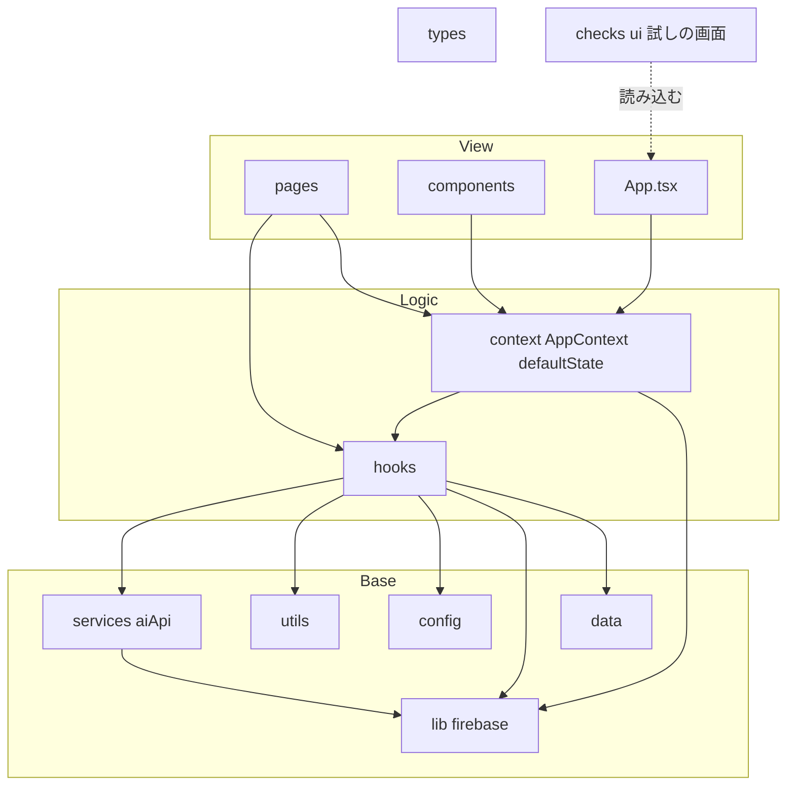
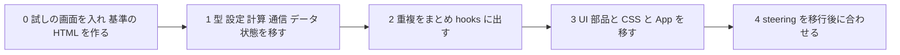

# Design Document: src-structure-migration

## Overview

**Purpose**：`src/` のファイルを `structure.md` の目標の構成に移し、散らばった計算を1か所にまとめる。後続の spec（`university-data-model`・`ui-design-definition`・`empty-slot-search`・`first-run-ux-refresh`）が、決まった場所の部品を使って作れるようにする。
**Users**：作者と Claude（開発する人）。利用者から見える見た目と動きは何も変えない。
**Impact**：`logic/`・`ai/`・`ui/`・`data.ts`・`components/App.tsx` がなくなり、`types/`・`config/`・`utils/`・`services/`・`context/`・`hooks/`・`assets/`・`data/` に分かれる。あわせて、移行の前後で動きが同じことを確かめる「試しの画面」を `checks/ui/` に入れ、`npm run check:ui` で流せるようにする。

### Goals
- `structure.md` の目標の構成（＋`config/`）にすべてのファイルを置き、依存の向きを守る（2）
- 学期・クォーターの判定（9か所）とセル探し（2か所）を1か所にまとめる（3）
- 後続の spec が使う計算・通信・裏側の処理を部品にする（4）
- 移行の前後で、見た目（画面の HTML）と動きが同じことを、1つのコマンドで確かめられる（1・5）

### Non-Goals
- 見た目・文言・画面の流れ・データの形の変更、不具合の修正、未使用のコードの削除
- lint の指摘をゼロにすること、後続の spec が使わない画面の中の計算（GPA シミュレーター、成績入力の一覧など）の整理
- ルートの `api/` の変更

## Boundary Commitments

### This Spec Owns
- `src/` のファイルの置き場所と、フォルダ間の依存の向き
- まとめた計算の関数（`utils/targetBit.ts` の学期・クォーターの判定、`utils/timetable.ts` のセル探し）の形
- 画面ごとの裏側の処理の hook（`hooks/`）の形
- 試しの画面（`checks/ui/`）と、`npm run check:ui`
- `config/` を目標の構成に足すこと

### Out of Boundary
- 動きの変更・不具合の修正（見つけたら `tasks.md` の Implementation Notes に記録して、別に扱う）
- 大学ごとの設定の形（`university-data-model`）。この spec では `config/universityConfig.ts` に移すだけ
- 見た目の決まり（`ui-design-definition`）、画面の作り直し（`first-run-ux-refresh`）
- データの形（`data-model.md` の型の中身）、`api/`、Firestore のルール

### Allowed Dependencies
- 依存の向き：`pages/`・`components/` → `hooks/`・`context/` → `services/`・`utils/`・`config/`・`lib/`・`data/`。`types/` はどこからでも
- 画面・UI 部品が `utils/` を使ってよいのは、表示のための小さな関数（`cn`・`getSubjectColor`・ラベル・`formatYearMonth` など）と、この spec で整理しない画面の中の計算だけ。画面ごとの計算の組み合わせ・通信・保存は `hooks/` を通す
- `firebase/*` を import してよいのは `lib/`・`hooks/`・`context/` だけ
- 試しの画面（`checks/ui/`）は `src/` を読み込んでよい。`src/` は `checks/` を読み込まない

### Revalidation Triggers
- `utils/targetBit.ts` の関数の形を変えるとき → `university-data-model`（ビットの意味を大学ごとの設定にする）で読み直す
- `hooks/useTimetablePatterns.ts`・`utils/timetable.ts` の形を変えるとき → `empty-slot-search` で読み直す
- 試しの画面の偽物の部品（`checks/ui/mocks/`）が、本物の `lib/firebase.ts` の export と合わなくなったとき → 試しの画面を直す
- `hooks/useUserDataSync.ts` の保存のタイミングを変えるとき → 保存の確認をすべて流し直す

## Architecture

### Existing Architecture Analysis
- 状態は `AppContext`（347行）1つ。認証の監視・読み込み・3秒まとめた保存・閉じるときの保存・更新関数がすべて入っている
- 画面ファイルに計算が直接ある：学期・クォーターの判定（`GeneratorScreen`・`DashboardScreen`・`CourseSelectionScreen`）、セル探し（`GeneratorScreen` のプレビュー・`DashboardScreen` の時間割）、AI の呼び出し（`ProposalScreen`・`GeneratorScreen`・`GradeInputScreen`）
- `logic/timetableGenerator.ts` に、ラベル・絞り込み・合否・時間割の計算・未使用のモックが混ざっている

### Architecture Pattern & Boundary Map



- `context/AppContext.tsx` は、保存と認証の監視を `hooks/useUserDataSync.ts` に任せ、更新関数（`updateProfile` など）とログイン・ログアウトだけを持つ
- 画面は、計算の組み合わせ・通信を画面ごとの hook から受け取って描画する

### Technology Stack
| Layer | Choice / Version | Role in Feature | Notes |
|-------|------------------|-----------------|-------|
| Frontend | React 19 / TypeScript 5.9 / Vite 8 | 移すだけ | 新しいライブラリは使わない |
| 試しの画面 | Playwright 1.56.1（`devDependencies` に追加）、Vite の開発サーバー | 本物の画面を動かして確かめる | 作者のパソコンでは最初に1回 `npx playwright install chromium` |

## File Structure Plan

### Directory Structure（移行後）
```
src/
├── main.tsx                     # エントリ（CSS の読み込み先だけ変わる）
├── App.tsx                      # ← components/App.tsx（認証ゲート・画面切替・読み込み失敗の画面）
├── vite-env.d.ts
├── assets/styles/               # ← ui/styles/（index.css・App.css。App.css は未使用だが残す）
├── components/                  # ← ui/Header.tsx・ui/Button.tsx と、今の components/*（App.tsx を除く）
├── pages/                       # 画面8つ（場所は変わらない。中の計算・通信を hooks に出す）
├── hooks/
│   ├── useUserDataSync.ts       # 認証の監視・読み込みの状態・3秒まとめた保存・すぐ書く保存（AppContext から分ける）
│   ├── useAvailableCourses.ts   # 画面3：今の学年の科目と下の学年の未合格の科目、選択単位数、40科目の上限つきの選択
│   ├── useConsultation.ts       # 画面4：AI 相談の呼び出しと、残す科目の選択・確定
│   ├── useTimetablePatterns.ts  # 画面5：パターンの取得、割り当て、退避、プレビューのセル、確定
│   ├── useTimetableGrid.ts      # 画面6：ダッシュボードの時間割のセル、集中講義、表示の範囲の外の時限
│   └── useGradeReaction.ts      # 画面7：成績へのリアクションの呼び出し
├── context/
│   ├── AppContext.tsx           # ← logic/AppContext.tsx（更新関数・ログイン・ログアウト。保存は useUserDataSync）
│   └── defaultState.ts          # ← logic/types.ts の defaultState
├── services/
│   └── aiApi.ts                 # ← ai/aiService.ts（中身は変えない）
├── utils/
│   ├── targetBit.ts             # ビットの読み取り：学期・クォーターの判定（まとめた関数）、対象学年、ラベル、再履修、未使用の calculateStudentBit・canTakeClass
│   ├── courseFilter.ts          # 受講できる科目：filterByBit・isRetakeCandidate
│   ├── grades.ts                # 合否：isPassingGradePoint・isCoursePassed・isCourseFailed
│   ├── timetable.ts             # 時間割：findClassesInSlot（まとめたセル探し）・isIntensiveEntry・resolveClassAssignments・getLatestPeriod・未使用の checkScheduleConflict・parseTimeSlot・DAYS・PERIODS
│   ├── timetableMock.ts         # 未使用のモック generateTimetables（消さずに移す）
│   ├── studentPeriod.ts         # 入学・卒業予定年月
│   ├── subjectColor.ts          # getSubjectColor
│   └── classNames.ts            # cn
├── config/
│   ├── universityConfig.ts      # ← logic/universityConfig.ts
│   └── inputLimits.ts           # ← logic/inputLimits.ts
├── lib/firebase.ts              # 場所は変わらない
├── types/index.ts               # ← logic/types.ts の型（値と関数は置かない）
└── data/
    ├── index.ts                 # ← data.ts（MOCK_COURSES）
    └── *.json                   # 変わらない

checks/ui/                       # 試しの画面（本番のビルドに入らない）
├── run.mjs                      # 開発サーバーを立て、Playwright ですべての確認を流し、結果を表示する
├── vite.config.ts               # firebase/auth・firebase/firestore・src/lib/firebase を偽物に差し替える
├── index.html                   # 偽物の準備（setup.ts）→ 本物の入口（/src/main.tsx）の順に読み込む
├── setup.ts                     # window.__h（ログイン・保存データ・setDoc の記録）を用意する
├── mocks/                       # firebase-auth.ts・firebase-firestore.ts・lib-firebase.ts
├── scenarios/                   # 確認を種類ごとに（*.mjs）
└── snapshots/                   # 画面の HTML の基準（移行前に作る）
```

### Modified Files（移すだけでなく中身も変わるもの）
- `src/main.tsx` — CSS と `App` の読み込み先
- `src/pages/CourseSelectionScreen.tsx`・`ProposalScreen.tsx`・`GeneratorScreen.tsx`・`DashboardScreen.tsx`（時間割のタブ）・`GradeInputScreen.tsx` — 計算・通信を hook から受け取る。JSX は変えない
- 全ファイルの import の書き換え
- `package.json` — `devDependencies` に `playwright`、`scripts` に `check:ui`
- `.gitignore` — 試しの画面の一時ファイル（スクリーンショットなど）を入れない

## Steering Impact

| Steering file | Changes? | What changes | When it is updated |
|---------------|----------|--------------|--------------------|
| `product.md` | Yes | ファイルの場所の記述（`src/logic/universityConfig.ts`・`src/logic/timetableGenerator.ts` の `isCoursePassed`）を新しい場所に | ファイルを移すタスクの中 |
| `tech.md` | Yes | 「テスト：なし」→ 試しの画面（`npm run check:ui`、何を確かめるか、Playwright のブラウザの入れ方）。開発コマンド。ファイルの場所（`src/ai/aiService.ts`・`src/data.ts`・`ErrorBoundary`・`ui/styles` など） | 試しの画面のタスクと、ファイルを移すタスクの中 |
| `structure.md` | Yes | 目標の構成に `config/` と `checks/ui/` を足す。「現状のディレクトリ構成」「現状からの対応」「依存の向き（現状）」を移行後に。画面に残っている計算（GPA シミュレーターなど）を書く | `config/` は最初のタスク、ほかは各段階と最後のタスク |
| `data-model.md` | Yes | 型の場所（`src/logic/types.ts`・`src/ai/aiService.ts`）を新しい場所に。型の中身は変えない | 型を移すタスクの中 |
| `deployment.md` | No | ファイルの場所の記述がない。デプロイの手順は変わらない | — |
| `roadmap.md` | No | spec の順番・範囲は変わらない（完了のチェックは本番の確認のあと） | — |

## System Flows

### 移行の段階と確認

- 各段階のあとに `npm run build` と `npm run check:ui` を流し、すべて通ってから次へ進む（1.5）
- 段階0は移行の前のコードで行う。ここで作った画面の HTML の基準と、すべての確認の結果が、段階1〜3の比べる相手になる

## Requirements Traceability

| Requirement | Summary | Components | Interfaces / Flows |
|-------------|---------|------------|--------------------|
| 1.1 | 見た目と文言が同じ | 試しの画面（画面の HTML の比較）、全画面 | `snapshots/` |
| 1.2 | 保存の動きが同じ | useUserDataSync、試しの画面 | 保存の確認 |
| 1.3 | AI の呼び出しが同じ | services/aiApi、useConsultation・useTimetablePatterns・useGradeReaction | AI の確認 |
| 1.4 | ピン・合否・時限・上限・年月・ログインが同じ | utils、hooks、試しの画面 | 各確認 |
| 1.5 | 各段階でビルドと確認が通る | 移行の段階 | System Flows |
| 2.1 | 表どおりに置く | File Structure Plan | — |
| 2.2 | 設定は config/ | config/ | — |
| 2.3 | 画面は見た目だけ | pages、hooks | Allowed Dependencies |
| 2.4 | 依存の向き | 全体 | Boundary Map、import の確認 |
| 2.5 | Firebase は lib・hooks・context だけ | lib、hooks、context | import の確認 |
| 2.6 | 新しいコードで any を使わない | 全体 | lint |
| 2.7 | 古いフォルダを残さない | 移行の段階3 | ファイルの確認 |
| 3.1 | 学期・クォーターの判定を1か所 | utils/targetBit | `isInSessionTerm`・`getQuarterType` |
| 3.2 | セル探しを1か所 | utils/timetable、useTimetablePatterns、useTimetableGrid | `findClassesInSlot` |
| 3.3 | 違いを残してまとめる | useTimetablePatterns、useTimetableGrid | 一覧の作り方を hook に残す |
| 3.4 | 不具合は記録して直さない | 作業 | Implementation Notes |
| 4.1 | 通信を1か所 | services/aiApi | — |
| 4.2 | 計算を画面に依存しない場所に | utils | — |
| 4.3 | Firestore 同期を hooks に | useUserDataSync、context | — |
| 4.4 | 画面3・5・6 の裏側の処理 | useAvailableCourses、useTimetablePatterns、useTimetableGrid | — |
| 5.1 | 1つのコマンドで流して結果を表示 | checks/ui/run.mjs | `npm run check:ui` |
| 5.2 | 第1段階と student-period の流れ | checks/ui/scenarios | Testing Strategy |
| 5.3 | 本物に接続しない・秘密情報を使わない | checks/ui/vite.config.ts、run.mjs | 外への通信を止める |
| 5.4 | 移行の前後で同じように流せる | checks/ui/index.html（本物の入口を読む）、mocks | — |
| 5.5 | 本番のビルドに偽物を入れない | checks/ui を src の外に | ビルドの出力の確認 |
| 6.1 | structure.md を更新 | structure.md | 段階4 |
| 6.2 | ほかの steering のファイルの場所 | tech.md・data-model.md・product.md | 各タスク |
| 6.3 | tech.md のテストの説明 | tech.md | 試しの画面のタスク |

## Components and Interfaces

| Component | Layer | Intent | Req Coverage |
|-----------|-------|--------|--------------|
| utils/targetBit | utils | ビットの読み取り（学期・クォーター・対象学年・ラベル） | 3.1, 4.2 |
| utils/timetable | utils | セル探し・ピン・時限 | 3.2, 4.2 |
| useUserDataSync | hooks | 認証の監視・読み込み・保存 | 1.2, 4.3 |
| useAvailableCourses | hooks | 画面3 の科目の一覧と選択 | 1.4, 4.4 |
| useConsultation | hooks | 画面4 の AI 相談 | 1.3, 2.3 |
| useTimetablePatterns | hooks | 画面5 の生成とプレビュー | 1.3, 1.4, 3.2, 3.3, 4.4 |
| useTimetableGrid | hooks | 画面6 の時間割 | 1.4, 3.2, 3.3, 4.4 |
| useGradeReaction | hooks | 画面7 の AI リアクション | 1.3, 2.3 |
| 試しの画面（checks/ui） | 開発の道具 | 移行の前後で同じかを確かめる | 1.1–1.5, 5.1–5.5 |

### utils

#### utils/targetBit.ts（まとめた判定）
```typescript
export type QuarterType = 'odd' | 'even' | 'across' | 'intensive';
export type Term = AppState['timetableConditions']['term']; // 'first' | 'second' | 'full'

/** 学期のビット（bit 8-9）。0=前期 1=後期 2=通年 */
export function getTermBit(bit: number): number;
/** 今の学期の値（'first'→0、'second'→1、'full'→2） */
export function toSessionTermBit(term: Term): number;
/** 通年（2）なら常に、それ以外は今の学期と一致すれば true。今の9か所の判定と同じ */
export function isInSessionTerm(bit: number, term: Term): boolean;
/** クォーター（bit 6-7）。0=odd 1=even 2=across 3=intensive */
export function getQuarterType(bit: number): QuarterType;
// 今ある getTargetGrades・getTermLabel・getQuarterLabel・getPeriodLabel・isRetakeCourse は中身を変えずに移す
```
- 科目の絞り込み（`courseFilter.ts`）と画面3 の「下の学年の科目」の学期の判定は `isInSessionTerm` を使う。`getTermLabel`・`getQuarterLabel` も中で `getTermBit`・`getQuarterType` の値を使うが、返す文字列は変えない

#### utils/timetable.ts（まとめたセル探し）
```typescript
export interface TimetableEntry {
  courseId: string;
  classId: string;
  schedule: TimeSlot[];
  targetBit: number;
}

/** その曜日・時限に入る授業。学期が合わない・今のクォーターでない（またぎは常に対象）・集中講義は除く */
export function findClassesInSlot(
  entries: TimetableEntry[], slot: string, term: Term, activeQuarter: 'odd' | 'even'
): TimetableEntry[];

/** 集中講義などの欄に出す授業（学期が合い、集中講義か、"曜日-時限" の形のコマがない） */
export function findIntensiveEntries(entries: TimetableEntry[], term: Term): TimetableEntry[];
```
- 生成画面は、今の `getPreviewCellClasses` と同じく、退避していない科目 × 割り当てたクラスから `TimetableEntry` を作る（`targetBit` は `classInfo.target_bit ?? course.target_bit ?? 0`）。返り値は今と同じ `{ courseId, classId }` を描画に使う
- ダッシュボードは、確定済みの授業から作る（`targetBit` は `c.targetBit ?? 0`、`schedule` は `c.schedule ?? []`）。今の `getIntensiveClasses` は `findIntensiveEntries` に置きかえる

### hooks

#### useUserDataSync
```typescript
export function useUserDataSync(): {
  user: User | null;
  authLoading: boolean;
  loadStatus: LoadStatus;
  state: AppState;
  setState: React.Dispatch<React.SetStateAction<AppState>>;
  /** 待っている保存をすぐ書く（ログアウトの前に使う） */
  flushSave: () => Promise<void>;
  /** ログアウトを始めるときに、この利用者の保存を止める。戻り値の関数で元に戻す（ログアウトに失敗したとき） */
  stopSavingForSignOut: () => () => void;
};
```
- 今の `AppContext` の `onAuthStateChanged`・読み込みの番号・`readyUidRef`・`loadedStateRef`・`pendingSaveRef`・`flushSave`・`visibilitychange`/`pagehide` の処理を、**そのまま**移す（並びとタイミングを変えない）
- `AppContext` の `logout` は、`stopSavingForSignOut` → `flushSave`（最大3秒待つ）→ `signOut` の順で今と同じに動く

#### 画面ごとの hook（共通の決まり）
- 画面にある `useState`・`useEffect`・計算・AI の呼び出し・`setState` の組み合わせを、**そのまま** hook に移し、画面は返り値で描画する。JSX は変えない
- `useAvailableCourses`：`currentCourses`・`earlierCourses`・`selectedCredits`・`toggleCourse(course): { ok: true } | { ok: false; message: string }`（上限のときの文言は画面が `alert` で出す。今と同じ文言）
- `useConsultation`：`loading`・`isComplete`・`error`・`consultation`・`selectedToKeep`・`toggleCourse`・`finalize`
- `useTimetablePatterns`：`isGenerating`・`isComplete`・`error`・`patternsData`・`activePatternIndex`・`selectPattern`・`editableAssignments`・`changeAssignment`・`hiddenCourseIds`・`hideCourse`・`restoreCourse`・`restoreAll`・`activeQuarter`・`setActiveQuarter`・`termQuarters`・`days`・`periods`・`getPreviewCellClasses`・`latestPreviewPeriod`・`commit`
- `useTimetableGrid`：`activeQuarter`・`setActiveQuarter`・`termQuarters`・`days`・`periods`・`getCellClasses`・`intensiveClasses`・`latestCommittedPeriod`
- `useGradeReaction`：`isGenerating`・`reaction`・`generateReaction(grades)`

### 試しの画面（checks/ui）
- `run.mjs`：Vite の開発サーバーを `checks/ui/vite.config.ts` で（プロジェクトのフォルダから）立てる → Playwright で Chromium を開く → `scenarios/` の確認を順に流す → 確認ごとに PASS/FAIL を出し、最後に「通った数／通らなかった確認の名前」を出す。1つでも通らなければ終了コード 1
- `localhost` 以外への通信は Playwright で止める（本物の Firebase・Google・本番に接続しない。5.3）。AI 窓口（`/api/*`）は確認ごとに偽の返事を返す
- `index.html` は `setup.ts` を読み込んでから本物の入口 `/src/main.tsx` を読み込む。偽物への差し替えは import の名前（`firebase/auth`・`firebase/firestore`・`…/lib/firebase`）で決めるので、移行の前後で同じに動く（5.4）
- 画面の HTML の比較：決まった保存データで各画面（ログイン・オンボーディング・条件・科目選択・相談・生成・ダッシュボードの3タブ・成績入力、読み込み失敗の画面）を開き、`#root` の HTML を `snapshots/` の基準と比べる。`npm run check:ui -- --update-snapshots` で基準を作り直す（段階0でだけ使う）
- `checks/` は `src/` の外にあり、`tsconfig.app.json`（`src` だけ）と本番のビルドの対象にならない（5.5）。偽物の部品（`.ts`）は ESLint の対象なので、指摘が出ない書き方にする

## Error Handling
- 移行の途中で試しの画面の確認が通らなくなったら、次の段階に進まず、その段階の変更から原因を探す（試しの画面の基準は直さない）
- 移行の前から通らない確認があった場合（段階0）は、その確認を試しの画面に入れる前に作者に報告する（不具合として別に扱う）

## Testing Strategy

`npm run check:ui` の確認（第1段階・`student-period` で作ったものを持ち込み、足りないものを足す）：

- **見た目（1.1）**：画面の HTML の比較（上の画面の一覧。パソコンの幅とスマートフォンの幅）
- **保存（1.2）**：ログイン直後に保存しない、読み込みに失敗したら保存せず失敗の画面、保存データがなければ初期値で1回作る、利用者の切り替えで前の人の状態を書かない、続けて入力すると3秒後に1回、`merge` なしで書く、ページを隠す・閉じる・ログアウトの前にすぐ書く、保存の失敗で画面が止まらない
- **AI（1.3）**：トークンを付けて呼ぶ、401 でログイン画面に戻る、400・500 で先輩の口調の文面、送るプロフィールの項目、相談・生成・成績のリアクションが表示される
- **そのほかの動き（1.4）**：ピンが5パターンと代わりの時間割で守られる、無効なピンは使わない、確定済みの授業の削除が完全一致、新学期で D/F が修得済みに入らない、最大時限 5〜11 と表示の範囲の外の知らせ、41科目目を選べない、入学・卒業予定年月の確かめと保存、ログインのポップアップを閉じても失敗の文言を出さない、全体の流れ（ログイン → ピンの解除 → 相談 → 生成 → 確定 → 最大時限 → 成績 → 新学期）
- **構成（2）**：各段階のあとに、`src/pages`・`src/components` が `firebase/*`・`services/` を import していないこと、`utils/`・`services/`・`config/` が `hooks/`・`context/`・`pages/` を import していないこと、移行後に `src/logic`・`src/ai`・`src/ui`・`src/data.ts`・`src/components/App.tsx` がないことを `grep` で確かめる
- **本番のビルド（5.5）**：`npm run build` の出力に `window.__h`・`checks/` の文字列がないこと
- **作者による本番での確認**：移行のあとに本番 URL で、共通の確認 1〜6 を行う（`roadmap.md`）
