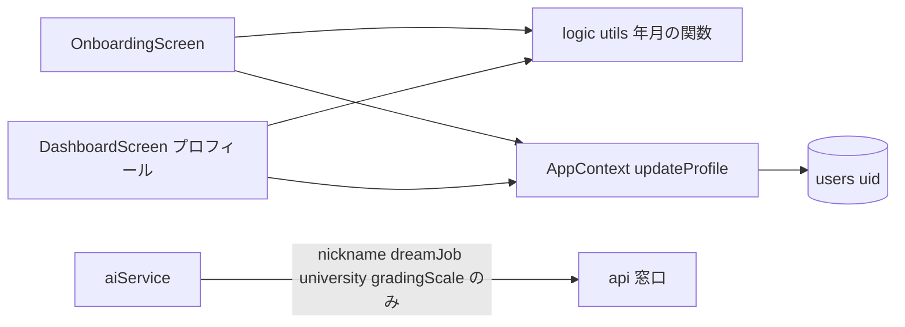

# Design Document: student-period

## Overview

**Purpose**：利用者が入学年月と卒業予定年月を、プロフィールに任意で入れておけるようにする。将来、就職・インターンで企業とつなぐときの土台にする（この spec では企業には渡さない）。
**Users**：会津大学の学生が、オンボーディングとダッシュボードのプロフィールで使う。
**Impact**：`userProfile` に2つの文字列の項目が増える。保存・読み込みの流れ、Firestore のルール、AI 窓口（サーバー）は変えない。AI の依頼では、ブラウザが送るプロフィールの項目を、サーバーが使うものだけに絞る。

作者の方針（2026-10-29）により、**なるべくシンプルに作る**。新しいファイルは作らず、今あるファイルに足す。

### Goals
- オンボーディングとプロフィールで、2つの年月を年と月のプルダウンで入れる・変える・消すことができる（1・2）
- 年と月の片方だけ、卒業予定が入学より後でない組み合わせを保存させない（1.5・2.6・3）
- 入れた年月がログインし直しても残り、ほかのデータを変えない（4）
- 年月を AI の依頼に含めない（5）

### Non-Goals
- 卒業予定の初期値の自動入力、学年の自動計算
- 企業やほかのサービスに渡すこと、同意の画面、集める理由の説明
- 今の利用者に入力を求める画面
- 年月の入力欄を共通の部品にすること（第2段階の `src-structure-migration`・`ui-design-definition` で行う）

## Boundary Commitments

### This Spec Owns
- `userProfile.enrollmentYearMonth`・`userProfile.expectedGraduationYearMonth` の形（`"YYYY-MM"` または `''`）と意味
- 年月の形・前後・選べる年の範囲を確かめる関数（`src/logic/utils.ts`）と、そのエラーの文言
- オンボーディングとダッシュボードのプロフィールの、年月の入力欄と表示
- AI の依頼で送るプロフィールの項目を、サーバーが使うものだけに絞ること（`src/ai/aiService.ts`）

### Out of Boundary
- 保存・読み込みの流れ（`AppContext` の `loadStatus`・3 秒まとめた保存）。そのまま使い、変えない
- Firestore のルール（`firestore.rules`）。同じ `users/{uid}` に入るので変えない
- AI 窓口（`api/`）。サーバーの入力の確認・プロンプトは変えない
- 条件設定の学年（`timetableConditions.targetGrade`）との結び付け
- 企業との連携、データの移し替え

### Allowed Dependencies
- `AppContext` の `updateProfile`（プロフィールの一部を書く）と `state.userProfile`
- `src/logic/utils.ts` の新しい関数（画面はここだけを使って確かめる。画面の中で別の確かめ方をしない）
- 画面から `firebase/*` を直接 import しない（今の決まりのまま）

### Revalidation Triggers
- `userProfile` の年月の形（`"YYYY-MM"`）を変えるとき → 将来の企業との連携の spec と、`university-data-model`（ユーザーデータの形を変える）で読み直す
- AI 窓口がプロフィールの別の項目を使うようにするとき → `aiService.ts` で送る項目を足す
- `university-data-model` でユーザーデータを学期ごとに分けるとき → 年月はプロフィール（学期によらない）に残すことを確かめる

## Architecture

### Existing Architecture Analysis
- 状態は `AppContext` の `AppState` 1つ。読み込み時に `userProfile` を `defaultState.userProfile` と1段深く重ねるので、項目を足すと今の利用者は自動で `''` になる（4.2）
- 保存は `ready` のときだけ、最後の変更から 3 秒後に `merge` なしで丸ごと書く。年月もこの流れで保存される（4.1・4.3）
- オンボーディングは入力のたびに `updateProfile` で状態に書く。ダッシュボードのプロフィールは「編集する」で画面の中に下書きを持ち、「保存する」で `updateProfile`・`updateSettings` を呼ぶ（2026-10-24 の最大時限と同じ作り）

### Architecture Pattern & Boundary Map



- 画面は「下書き（年と月の文字列）」を持ち、`utils.ts` の関数で確かめてから `updateProfile` で `"YYYY-MM"` か `''` を書く。途中の状態（年だけ）は保存データに入らない
- AI の依頼は `aiService.ts` が送る項目を選ぶので、プロフィールに項目が増えても AI には届かない

### Technology Stack
| Layer | Choice / Version | Role in Feature | Notes |
|-------|------------------|-----------------|-------|
| Frontend | React 19 / TypeScript 5.9 | 年と月の `<select>`、下書きの状態 | 新しいライブラリは使わない |
| Data / Storage | Cloud Firestore（`users/{uid}`） | `userProfile` の2項目を保存 | 今の保存の流れのまま |

## File Structure Plan

新しいファイルは作らない。

### Modified Files
- `.kiro/steering/data-model.md` — `userProfile` に2項目、AI の依頼のプロフィールの形（送る項目だけ）を書く。**コードより先に直す**
- `src/logic/types.ts` — `AppState['userProfile']` に2項目、`defaultState` に `''` を足す
- `src/logic/utils.ts` — 年月の下書きの型と、変換・確かめ・選べる年・表示の関数、エラーの文言を足す
- `src/pages/OnboardingScreen.tsx` — 年月の下書きを持ち、入学・卒業予定のプルダウンを出す。「次へ」で確かめ、通れば `updateProfile` で書いて進む
- `src/pages/DashboardScreen.tsx` — プロフィールのタブで年月を表示し、「編集する」で下書きに入れ、「保存する」で確かめてから書く
- `src/ai/aiService.ts` — 相談と成績のリアクションで、サーバーが使うプロフィールの項目だけを送る
- `.kiro/steering/product.md` — オンボーディングとプロフィールの項目に年月を足す
- `.kiro/steering/structure.md` — `logic/utils.ts` の説明に年月の関数を足す

## Steering Impact

| Steering file | Changes? | What changes | When it is updated |
|---------------|----------|--------------|--------------------|
| `product.md` | Yes | オンボーディングとダッシュボードのプロフィールで、入学・卒業予定年月を任意で入れられる（年の範囲、前後の確認、AI と企業に渡さない） | 画面のタスクの中 |
| `tech.md` | No | 技術の決まり・パターンは変わらない（AI 窓口のパターンもそのまま） | — |
| `structure.md` | Yes | ファイルは増えないが、`logic/utils.ts` の役割の説明に「年月の確かめと表示」を足す | `utils.ts` のタスクの中 |
| `data-model.md` | Yes | `userProfile` の2項目（形・初期値・前後の決まり・保存の扱い）、`ConsultationRequest`・`GradeReactionRequest` のプロフィールを送る項目だけの形に | 最初のタスク（コードより先） |
| `deployment.md` | No | 環境変数・管理画面の作業・Firestore のルールは変わらない | — |
| `roadmap.md` | No | spec の追加と順番は 2026-10-28・29 に反映済み | — |

## Requirements Traceability

| Requirement | Summary | Components | Interfaces |
|-------------|---------|------------|------------|
| 1.1 | オンボーディングに年と月の欄 | OnboardingScreen | `getYearOptions`, `MONTH_OPTIONS` |
| 1.2 | 最初は空 | OnboardingScreen | `toYearMonthDraft('')` |
| 1.3 | 入学を選んでも卒業予定を変えない | OnboardingScreen | 下書きは項目ごとに独立 |
| 1.4 | 空でも進める | OnboardingScreen, Utils | `validateStudentPeriod` |
| 1.5 | 片方だけなら進ませない | OnboardingScreen, Utils | `validateStudentPeriod` |
| 2.1 | プロフィールに表示 | DashboardScreen | `formatYearMonth` |
| 2.2 | 未設定の表示 | DashboardScreen, Utils | `formatYearMonth('')` |
| 2.3 | 編集で今の値が選ばれた状態 | DashboardScreen | `toYearMonthDraft` |
| 2.4 | 空に戻して保存で未設定 | DashboardScreen, Utils | `validateStudentPeriod` |
| 2.5 | 保存で表示に反映 | DashboardScreen, AppContext | `updateProfile` |
| 2.6 | 片方だけなら保存しない | DashboardScreen, Utils | `validateStudentPeriod` |
| 3.1 | 後でない組み合わせを断る | Utils, 2画面 | `validateStudentPeriod` |
| 3.2 | 片方だけなら前後を見ない | Utils | `validateStudentPeriod` |
| 3.3 | 直すと知らせが消える | 2画面 | 押したあとは入力のたびに確かめ直す |
| 3.4 | 選べる年は前後4年 | Utils | `getYearOptions`, `STUDENT_PERIOD_YEAR_RANGE` |
| 4.1 | ログインし直しても残る | Types, AppContext（既存） | `defaultState`, 保存の流れ |
| 4.2 | 今の利用者は未設定、入力を求めない | Types, AppContext（既存） | 読み込み時の重ね合わせ |
| 4.3 | ほかのデータを変えない | 2画面 | `updateProfile` で年月だけ書く |
| 4.4 | 本人だけの場所に保存 | Firestore のルール（既存） | `users/{uid}` |
| 5.1 | AI の依頼に含めない | AiService | `toApiProfile` |
| 5.2 | 企業に渡さない | （渡す仕組みを作らない） | — |

## Components and Interfaces

| Component | Layer | Intent | Req Coverage | Contracts |
|-----------|-------|--------|--------------|-----------|
| StudentPeriod utils（`src/logic/utils.ts`） | logic | 年月の変換・確かめ・選べる年・表示 | 1.4, 1.5, 2.2, 2.4, 2.6, 3.1–3.4 | Service |
| Types（`src/logic/types.ts`） | logic | `userProfile` の2項目と初期値 | 4.1, 4.2 | State |
| OnboardingScreen | pages | 年月の入力と、進む前の確認 | 1.1–1.5, 3.1, 3.3 | — |
| DashboardScreen（プロフィール） | pages | 年月の表示・編集・保存の前の確認 | 2.1–2.6, 3.1, 3.3, 4.3 | — |
| AiService（`src/ai/aiService.ts`） | ai | 送るプロフィールの項目を絞る | 5.1 | Service |

### logic

#### StudentPeriod utils（`src/logic/utils.ts` に追加）

**Contracts**: Service [x]

```typescript
/** 選べる年の幅（今年の前後 N 年）。3.4 */
export const STUDENT_PERIOD_YEAR_RANGE = 4;

/** 月の選択肢（1〜12） */
export const MONTH_OPTIONS: number[]; // [1, 2, ..., 12]

/** 画面の下書き。'' は未選択。year は "2026"、month は "4" のような文字列 */
export interface YearMonthDraft {
  year: string;
  month: string;
}

/** 保存の値（"YYYY-MM" か ''）を下書きにする。形が違う値は空の下書きにする */
export function toYearMonthDraft(value: string): YearMonthDraft;

/** 選べる年（今年 - 4 〜 今年 + 4）。keepYear が範囲の外なら、それも入れて昇順で返す */
export function getYearOptions(currentYear: number, keepYear?: string): number[];

/** 保存の値を表示用にする。"2026-04" → "2026年4月"、'' → "未設定" */
export function formatYearMonth(value: string): string;

export type StudentPeriodResult =
  | { ok: true; enrollmentYearMonth: string; expectedGraduationYearMonth: string } // "YYYY-MM" か ''
  | { ok: false; enrollmentError?: string; graduationError?: string };

/** 2つの下書きを確かめて、保存の値にする。1.4・1.5・2.4・2.6・3.1・3.2 */
export function validateStudentPeriod(
  enrollment: YearMonthDraft,
  graduation: YearMonthDraft
): StudentPeriodResult;
```

- 下書きの年と月が両方空なら `''`、両方入っていれば `"YYYY-MM"`（月は2桁）、片方だけならその項目のエラー「年と月の両方を選ぶか、両方を空にしてください」
- 両方の項目が `"YYYY-MM"` になり、卒業予定 ≦ 入学（文字列の比較）なら、卒業予定のエラー「卒業予定は入学より後の年月にしてください」（3.1）。片方だけ入っているときは比べない（3.2）
- 文言はこのファイルの定数にし、2つの画面は同じ文言を使う
- `getYearOptions` の `keepYear`：保存済みの年が年月の経過で範囲の外になっても、表示と保持ができるようにするため（範囲の外の年を新しく選ばせるためではない）

### pages

#### OnboardingScreen
- 画面の中に `enrollmentDraft`・`graduationDraft`（`YearMonthDraft`、初期値は `toYearMonthDraft(state.userProfile.…)`。はじめての人は空）と `showPeriodErrors`（押したかどうか）を持つ
- 「入学年月」「卒業予定年月」それぞれに、年の `<select>`（先頭に「年」の空の選択肢 + `getYearOptions(今年)`）と月の `<select>`（先頭に「月」の空の選択肢 + `MONTH_OPTIONS`）を並べる。どちらも任意と分かるラベルにする（例：「入学年月（任意）」）
- 「次へ」：今のニックネームの確認のあと、`validateStudentPeriod` を呼ぶ。`ok: false` なら `showPeriodErrors = true` にして進まない。`ok: true` なら `updateProfile({ enrollmentYearMonth, expectedGraduationYearMonth })` を呼んでから進む
- `showPeriodErrors` が true の間は、描画のたびに `validateStudentPeriod` の結果のエラーを各欄の下に出す（直すと消える。3.3）
- 入学の下書きを変えても、卒業予定の下書きは変えない（1.3）

#### DashboardScreen（プロフィールのタブ）
- 表示：「入学年月」「卒業予定年月」の行を足し、`formatYearMonth(state.userProfile.…)` を出す（2.1・2.2）
- 「編集する」（`handleStartEditProfile`）：2つの下書きに `toYearMonthDraft(今の値)` を入れ、`showPeriodErrors = false` にする（2.3）
- 編集中：オンボーディングと同じ形のプルダウン。年の選択肢は `getYearOptions(今年, 下書きの年)`
- 「保存する」（`handleSaveProfile`）：`validateStudentPeriod` が `ok: false` なら `showPeriodErrors = true` にして、ニックネームなども含めて何も保存せず編集を続ける（2.6）。`ok: true` なら今の `updateProfile`（ニックネーム・職業）に年月を足して1回で書き、`updateSettings`（最大時限）も今までどおり呼んで編集を閉じる（2.4・2.5・4.3）

### ai

#### AiService（`src/ai/aiService.ts`）

**Contracts**: Service [x]

```typescript
/** AI 窓口に送るプロフィール。サーバーが使う項目だけ（年月などはここに入れない）。5.1 */
type ApiProfile = Pick<AppState['userProfile'], 'nickname' | 'dreamJob' | 'university'>;
type ApiProfileWithScale = ApiProfile & Pick<AppState['userProfile'], 'gradingScale'>;
```
- `generateConsultation` は `{ nickname, dreamJob, university }` だけを、`generateGradeReaction` はそれに `gradingScale` を足したものだけを `userProfile` として送る
- 関数の引数（画面からの呼び方）は変えない。サーバー（`api/`）も変えない

## Data Models

### Logical Data Model（`data-model.md` に書く形）

```typescript
userProfile: {
  // 既存の項目はそのまま
  /** 入学年月。"YYYY-MM"（例 "2025-04"）。未設定は ''。任意 */
  enrollmentYearMonth: string;
  /** 卒業予定年月。"YYYY-MM"。未設定は ''。任意。両方入っているときは入学より後 */
  expectedGraduationYearMonth: string;
};
```
- 初期値（`defaultState`）はどちらも `''`。この機能より前の保存データには項目がなく、読み込み時に `''` になる（移し替えは要らない）
- 保存されるのは `"YYYY-MM"` か `''` だけ（年だけ・月だけの途中の状態は保存しない）
- 両方が `"YYYY-MM"` のとき、`expectedGraduationYearMonth > enrollmentYearMonth`（文字列の比較で前後が正しく決まる）
- AI の依頼（`ConsultationRequest`・`GradeReactionRequest`）の `userProfile` は、サーバーが使う項目だけの形に書き直す（年月は入らない）

## Error Handling

| 状況 | 画面の反応 |
|------|-----------|
| 年と月の片方だけ選んで「次へ」「保存する」 | その欄の下に「年と月の両方を選ぶか、両方を空にしてください」。進まない・保存しない |
| 卒業予定が入学と同じか前 | 卒業予定の欄の下に「卒業予定は入学より後の年月にしてください」。進まない・保存しない |
| 保存データの年月の形が違う（手で書き換えられたなど） | 下書きは空として扱い、表示は「未設定」。保存し直すまでデータはそのまま |
| 保存の失敗 | 今までどおり（`console.error` に記録し、画面は止めない） |

## Testing Strategy

テストの仕組みはないので、`secure-and-stable` と同じく、使い捨ての確認（`utils.ts` の関数を直接呼ぶ確認と、Firebase を偽物にした試しの画面）と、本番での手の確認で行う。

- **関数**：
  - `validateStudentPeriod`：両方空 → `''`/`''`、両方入って前後が正しい → 値、片方だけの欄 → その欄のエラー、同じ年月・前 → 卒業予定のエラー、入学だけ・卒業予定だけ → 前後を見ずに通る
  - `getYearOptions(2026)` が 2022〜2030、`getYearOptions(2026, "2019")` に 2019 が入る
  - `formatYearMonth`：`"2026-04"` → `"2026年4月"`、`''` → `"未設定"`
- **画面（試しの画面）**：
  - オンボーディング：最初は空、入学だけ選んでも卒業予定は空のまま、空で進める、年だけで「次へ」→ 知らせが出て進まず、月を選ぶと知らせが消えて進める、同じ年月で知らせ、正しく入れて進むと保存データに `"YYYY-MM"` が入る（1.1〜1.5・3.1〜3.3）
  - プロフィール：「未設定」の表示、編集で今の値が選ばれている、空に戻して保存で `''`、片方だけで保存すると知らせが出てニックネームの変更も保存されない、保存すると表示が変わる（2.1〜2.6）
  - 保存と影響：保存して開き直すと同じ年月、年月のない古い保存データで開くとオンボーディングに戻されずに「未設定」、年月を変えても時間割・成績・ピン・最大時限が変わらない（4.1〜4.3）
  - AI：年月を入れた状態で相談と成績のリアクションを呼び、依頼の本文に年月の項目がないことを確かめる（5.1）
- **本番**：実際のアカウントで年月を入れてログアウト・ログインし、残っていることを確かめる
- 毎回 `npm run build` と `npm run lint`（新しく足したコードに指摘がないこと）
