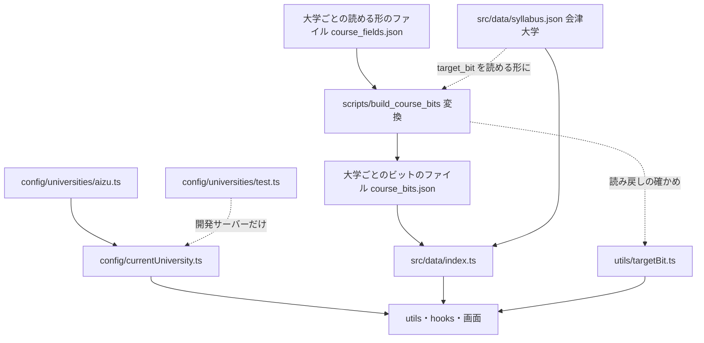

# Design Document: university-config

## Overview

**Purpose**：大学ごとに違う値を「大学ごとの設定」にまとめ、アプリの計算と表示がその設定を読むようにする。科目の条件（学年・学期・クォーター・再履修）は、どの大学も会津大学と同じビットの形（`target_bit`）で持つ。ほかの大学は、シラバスから4つを抜き出した読める形のファイルを作り、それをビットに詰めて、大学ごとに管理する。
**Users**：会津大学の利用者は今までどおり使う（成績の段階だけが実際のもの（D なし）になる）。作者は、試しの大学で設定どおりに動くことを確かめる。
**Impact**：大学ごとの設定のファイル、読める形とビットの形を行き来する変換のスクリプト、試しの大学のデータが増える。科目の条件の判定（`utils/targetBit.ts`）は今のまま使う。保存データの形は変えない。

作者の決定（2026-11-17）：

| 決めること | 決定 |
|------|------|
| 設定の置き方 | TypeScript のコードに書く（大学ごとに1ファイル） |
| 科目の条件の読み取り方 | どの大学も会津大学と同じビットの形（`target_bit`）で持つ。ほかの大学は、シラバスから学年・学期・クォーター・再履修を抜き出した読める形のファイルを作り、それを10進数のビットに詰めたファイルを大学ごとに管理する（2026-11-17、作者が「共通の形のまま読む」から変更） |
| 試しの大学への切りかえ | 開発サーバー（`npm run dev`・試しの画面）でだけ、環境変数 `VITE_UNIVERSITY=test` で切りかえる。本番のビルドでは必ず会津大学 |
| AI の成績のリアクションに渡す成績の段階 | 今までどおりブラウザから送る。送る値を、大学の設定の段階にする |

### Goals
- 大学ごとの設定に、大学名・学期制・時限・曜日・成績の段階・学年の範囲・ベースクラスを持つ（1）
- 計算と表示が、今の大学の設定と、科目のビット（`target_bit`）を読む（2）
- 会津大学の成績の段階を A=4・B=3・C=2・F=0 にし、D は F として扱う（3）
- 会津大学の利用者から見た動きを、成績の段階を除いて変えない（4）
- 試しの大学で、絞り込み・時間割・GPA が設定どおりになる（5）

### Non-Goals
- 保存データの形の変更、データの移し替え、大学 ID・科目 ID（`university-data-model`）
- クラスごとに別の科目になっている科目のまとめ、クラスごとの口コミ（`university-data-model`）
- 利用者が大学を選ぶ画面、本物の他大学のデータ
- 作者だけが開ける試しの環境（ステージング）

## Boundary Commitments

### This Spec Owns
- 大学ごとの設定の形（`UniversityConfig`）と、会津大学・試しの大学の設定
- 今の大学を決める部品（開発サーバーでだけ試しの大学に切りかえられる）
- 科目の条件の読める形（`CourseFields`）と、読める形とビットを行き来する変換のスクリプト
- 会津大学のビットを読める形にしたファイル（作者が見て確かめるため。アプリは使わない）
- 試しの大学のデータ（読める形で書き、ビットに詰めて使う）
- 計算と表示を、設定を読むように直すこと
- 成績の段階を大学の設定から読むこと（D → F の読みかえを含む）

### Out of Boundary
- 保存データ（`AppState`）の形。`userProfile.gradingScale`・`termSystem`・`university` は残すが、計算と表示には使わない（整理は `university-data-model`）
- 確定した時間割（`committedClasses`）に保存されている `targetBit` の形。これを読むところだけ、会津大学のビットの読み取りを残す（`university-data-model` で移し替えるまで）
- AI 窓口（`api/`）の中身。送られた成績の段階の形と上限を確かめる今の仕組みのまま
- シラバスの置き場所（`syllabus-db`）

### Allowed Dependencies
- `src/utils/targetBit.ts`（ビットの読み取り。今までどおりアプリの判定で使い、変換のスクリプトも読み戻しの確かめに使う）
- `src/data/index.ts`（シラバスと口コミを結合する場所。今の大学の科目データを選ぶ）

### Revalidation Triggers
- ビットの決まり（学年は6年まで、学期は前期・後期・通年、学期の中のクォーターは2つまで）に収まらない大学を足すとき：ビットの決まりを広げ、`targetBit.ts`・変換のスクリプト・設定を一緒に直す
- 読める形（`CourseFields`）を変えたとき：変換のスクリプトの読み戻しの確かめと、試しの画面を流し直す
- `university-data-model`：大学 ID から設定を引く形と、保存データの `targetBit` の移し替えを、この spec の設定の上に作る

## Architecture



- アプリの判定は、今までどおり科目のビット（`target_bit`）を `targetBit.ts` で読む。学期やクォーターの**名前**、曜日・時限・成績の段階などは、今の大学の設定から読む
- 会津大学は、今の `syllabus.json` の `target_bit` をそのまま使う。作者が確かめられるよう、ビットを読める形にしたファイルも作る（アプリは使わない）
- ほかの大学（今は試しの大学だけ）は、読める形のファイルを書き、変換のスクリプトでビットに詰める

### ビットの決まり（どの大学も同じ）

今の会津大学の決まりを、すべての大学で使う。

| ビット | 意味 | 値 |
|------|------|------|
| bit 0〜5 | 対象の学年 | 1年〜6年を1つずつ |
| bit 6〜7 | 学期の中のどこか | 0=1つめのクォーター、1=2つめのクォーター、2=学期を通して、3=集中講義など |
| bit 8〜9 | 学期 | 0=前期、1=後期、2=通年 |
| bit 10 | 再履修向けか | 1=再履修向け |

クォーターがない大学（試しの大学など）は、すべての科目を「学期を通して」（bit 6〜7 = 2）にする。

## File Structure Plan

### Directory Structure
```
src/
├── config/
│   ├── universityConfig.ts        # 変更：UniversityConfig の型と、選択肢を作る小さな関数（getSelectablePeriods など）
│   ├── universities/
│   │   ├── aizu.ts                # 新規：会津大学の設定
│   │   └── test.ts                # 新規：試しの大学の設定（開発サーバーでだけ使う）
│   └── currentUniversity.ts       # 新規：今の大学を決める（DEV かつ VITE_UNIVERSITY=test のときだけ試しの大学）
├── data/
│   ├── universities/
│   │   ├── u-aizu/
│   │   │   └── course_fields.json # 新規（生成物）：会津大学の target_bit を読める形にしたもの（作者が確かめるため。アプリは使わない）
│   │   └── test/
│   │       ├── courses.json       # 新規：試しの大学の小さな科目データ（target_bit なし）
│   │       ├── course_fields.json # 新規：試しの大学の科目の条件（読める形。手で書く）
│   │       └── course_bits.json   # 新規（生成物）：読める形をビットに詰めたもの（reviews_bit.json と同じ形）
│   └── index.ts                   # 変更：今の大学の科目データを選び、ビットを結合する
├── utils/
│   ├── timetable.ts               # 変更：曜日・クォーターの名前を大学の設定から読む
│   └── grades.ts                  # 変更：成績の段階を大学の設定から読み、読みかえ（D → F）を行う
scripts/
└── build_course_bits.ts           # 新規：読める形 ⇄ ビットの変換と確かめ（npm run build:course-bits）
```

### Modified Files
- `src/types/index.ts`：`UniversityConfig` を足す。`CourseFields`（読める形）は変換のスクリプトとデータファイルだけが使う（先に `data-model.md`）
- `src/hooks/useTimetableGrid.ts`・`useTimetablePatterns.ts`：曜日・クォーターの名前を設定から読む
- `src/hooks/useAvailableCourses.ts`：設定の成績の段階を使う（科目の条件の判定は今のまま）
- `src/context/AppContext.tsx`：「新学期へ進む」の合否と学年の上限を設定から読む
- `src/context/defaultState.ts`：初期値の大学名・学期制・成績の段階・ベースクラスを、会津大学の設定から作る
- `src/services/aiApi.ts`：成績のリアクションに送る成績の段階を、大学の設定のものにする
- 画面：条件（学年・ベースクラス）、科目選択（学期の名前・不合格の印）、成績入力（成績の選択肢）、ダッシュボード（GPA シミュレーター・学期の名前・プロフィールの大学名と学期制）、振り返り（成績の選択肢）
- `package.json`：`build:course-bits` のコマンド
- `checks/ui/`：試しの大学の確認を足す（試しの画面の開発サーバーに `VITE_UNIVERSITY=test` を渡す確認）
- steering：`data-model.md`・`product.md`・`tech.md`・`structure.md`

## Components and Interfaces

### 大学ごとの設定

```typescript
export interface TermDef {
  id: 'first' | 'second';
  label: string;                 // 例：'前期'
  quarters: { label: string }[]; // 学期の中のクォーター。会津大学は2つ（前期は Q1・Q2）。ない大学は []
}

export interface BaseClassGroup {
  grades: number[];              // この選択肢を出す学年
  options: string[];             // 例：['C1', 'C2', …]
}

export interface UniversityConfig {
  id: string;                    // 例：'u-aizu'（university-data-model で利用者のデータから引く）
  name: string;                  // 例：'会津大学'
  termSystemLabel: string;       // 例：'4学期制'
  terms: TermDef[];
  hasFullYearCourses: boolean;   // 通年の科目があるか
  days: string[];                // 授業のある曜日の最大（例：['月','火','水','木','金','土']）
  lastPeriod: number;            // 最後の時限
  minSelectablePeriod: number;   // 最大時限として選べるいちばん小さい値
  gradeRange: { min: number; max: number };
  baseClasses: BaseClassGroup[];
  gradingScale: { label: string; point: number }[];
  /** 保存データに残っている、今の段階にない成績の読みかえ（会津大学：D → F） */
  gradeAliases: Record<string, string>;
}
```

会津大学の値：`terms` は前期（Q1・Q2）と後期（Q3・Q4）、`hasFullYearCourses: true`、`days` は月〜土、`lastPeriod: 11`、`minSelectablePeriod: 5`、`gradeRange` 1〜6、`baseClasses` は1〜2年に C1〜C6・3年以上に CS・IT-SPR・SY・CN・IT-CMV・SE-DE、`gradingScale` は A=4・B=3・C=2・F=0、`gradeAliases` は `{ D: 'F' }`。

試しの大学の値（会津大学と違うところを持たせる）：前期・後期の2学期でクォーターなし、通年なし、月〜金、7限まで、学年 1〜4、ベースクラスは1つのグループ、成績の段階は S=4・A=3・B=2・C=1・F=0。

### 今の大学を決める

```typescript
// config/currentUniversity.ts
// 開発サーバー（import.meta.env.DEV）で、かつ VITE_UNIVERSITY=test のときだけ試しの大学。
// 本番のビルドでは DEV が false に置きかわり、試しの大学の分はビルドの結果から取り除かれる
export const currentUniversity: UniversityConfig;
```

### 科目の条件の読める形とビット

```typescript
/** 科目の条件の読める形（大学ごとのファイル course_fields.json の1件） */
export interface CourseFields {
  grades: number[];                         // 対象の学年（1〜6）
  term: 'first' | 'second' | 'full';        // 学期（通年は 'full'）
  slot: 'quarter1' | 'quarter2' | 'whole' | 'intensive';  // 学期の中のどこか
  isRetake: boolean;                        // 再履修向けか
}
// course_fields.json：{ "<科目の id_name>": { "course"?: CourseFields, "classes"?: { "<class_id>": CourseFields } } }
// course_bits.json：  [{ "id": "<科目の id_name>", "target_bit"?: number, "classes"?: { "<class_id>": number } }]（reviews_bit.json と同じく10進数）
```

- 科目全体とクラスのどちらに条件があるかは、今の `syllabus.json` と同じ形で持つ（科目にあれば科目に、クラスにあればクラスに）

### 変換のスクリプト（`npm run build:course-bits`）

2つの向きを持つ。

1. **読める形 → ビット**（ほかの大学用。今は試しの大学）
   - `course_fields.json` を読み、ビットの決まりで10進数に詰めて、`course_bits.json` に書き出す
   - 確かめ：詰めたビットを `targetBit.ts` で読み戻し、元の読める形と一致する。学年が設定の範囲の中、学期とクォーターが設定にある値（クォーターがない大学で quarter1・quarter2 を使っていない）。読み取れない値があれば止まる
2. **ビット → 読める形**（会津大学用。作者が確かめるため）
   - `syllabus.json` の `target_bit` を `targetBit.ts` で読み、`universities/u-aizu/course_fields.json` に書き出す
   - 確かめ：書き出した読める形を、もう一度ビットに詰めると、元の `target_bit` と一致する。科目とクラスの数が元と同じ

どちらも、1つでもおかしければファイルを書かずに止まり、科目の名前と理由を出す。元の `syllabus.json` は書きかえない。

スクリプトは TypeScript で書き、Node.js（22 以上）の型を取り除いて動かす仕組みで実行する。`targetBit.ts` をそのまま読み込んで、読み戻しの確かめに使う。動かし方は実装の最初に確かめる。

### 今の大学の科目データ

- `data/index.ts` は、今の大学が会津大学なら今までどおり `syllabus.json`（`target_bit` 入り）を、試しの大学なら `test/courses.json` に `test/course_bits.json` のビットを結合したものを使う
- アプリの判定（科目の絞り込み・時間割の表示）は、どちらの大学でも `targetBit.ts` でビットを読む。学期・クォーターの**名前**（前期・Q1 など）は、大学の設定から出す

### 成績の段階

- `grades.ts` の関数は、成績の段階を引数で受け取らず、大学の設定（`currentUniversity.gradingScale`）を使う形にする（呼ぶ側を12か所直す）
- 成績のラベルを引くとき、`gradeAliases` で読みかえてから段階を引く（D → F）。合否の判定（0 より上なら合格）は変えない
- 成績の選択肢（成績入力・振り返り・GPA シミュレーター）は、大学の設定の段階を出す
- AI の成績のリアクションに送る段階は、大学の設定のもの（`api/` は変えない）

### 保存データの `targetBit`

- 確定した時間割の表示（ダッシュボード）は、保存されている `targetBit` を `targetBit.ts` で読む今の形のまま残す
- 新しく確定する時間割も、今までどおり `targetBit` を保存する（保存データの形を変えないため）

## Requirements Traceability

| Requirement | Components |
|-------------|------------|
| 1.1–1.3 | `UniversityConfig`、`universities/aizu.ts`、`currentUniversity.ts` |
| 2.1 | ビットの決まり、`course_bits.json`、`data/index.ts`、`targetBit.ts`（今のまま） |
| 2.2 | `timetable.ts`、`useTimetableGrid.ts`、`useTimetablePatterns.ts`（曜日・クォーターの名前は設定から） |
| 2.3, 3.1–3.4 | `grades.ts`（設定の段階・読みかえ）、成績入力・ダッシュボード・振り返り・科目選択の画面、`AppContext`（新学期へ進む） |
| 2.4 | ダッシュボードのプロフィール、科目選択・ダッシュボードの学期の名前 |
| 2.5 | `aiApi.ts` |
| 2.6 | 条件の画面 |
| 4.1 | 会津大学は `target_bit` をそのまま使う、試しの画面の 122 件（HTML の比較を含む） |
| 4.2, 4.3 | 保存データの型を変えない、`aiApi.ts` の送る項目を増やさない |
| 5.1–5.3 | `universities/test.ts`、`data/universities/test/`、`build_course_bits.ts`、`currentUniversity.ts`、`checks/ui/` の確認 |
| 6.1–6.3 | 確認・本番の手順・steering |

## Testing Strategy

- **変換のスクリプト**：試しの大学の読める形 → ビットで、読み戻しが一致して生成物ができる。会津大学のビット → 読める形で、詰め直しが元の `target_bit` と一致する。わざとおかしな値を入れると止まる
- **試しの画面（会津大学）**：今までの 122 件がすべて通る。画面の HTML の比較のうち、成績の選択肢の出る画面（成績入力など）は D がなくなる分だけ変わるので、その差分が D の選択肢だけであることを確かめてから基準を作り直す
- **試しの画面（試しの大学）**：`VITE_UNIVERSITY=test` で開いて、学年の選択肢（1〜4）・ベースクラス・科目の絞り込み（2学期制・クォーターなし）・時間割の表示（月〜金・7限・クォーターの切りかえなし）・成績の選択肢（S〜F）・GPA を確かめる確認を足す
- **成績の段階**：D が入っている保存データで、GPA と合否が F と同じになる確認を足す
- **本番のビルド**：`dist/` に試しの大学の設定（大学名など）が入っていない
- **本番での確認（作者）**：会津大学で共通の確認 1〜6 と、成績の選択肢が A・B・C・F だけになったことを確かめる

## Security Considerations
- 試しの大学への切りかえは、開発サーバーでだけ効く。本番のビルドでは `import.meta.env.DEV` が false に置きかわるので、Vercel の環境変数を間違えても本番は会津大学のまま
- AI 窓口が受け取る成績の段階は、今までどおり形と上限を確かめる（3.1 の送る項目は増やさない）
