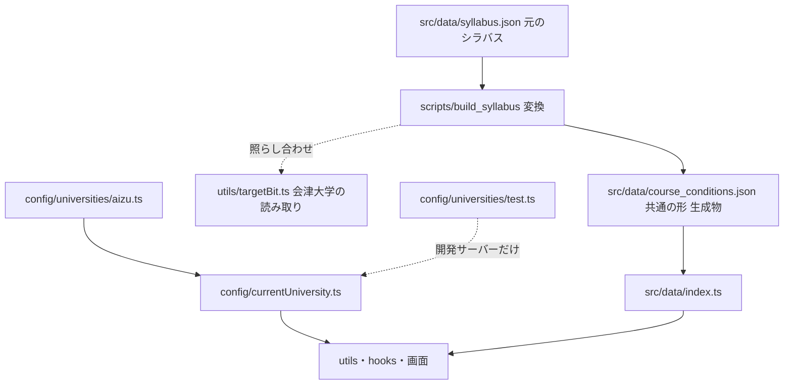

# Design Document: university-config

## Overview

**Purpose**：大学ごとに違う値を「大学ごとの設定」にまとめ、アプリの計算と表示がその設定を読むようにする。科目の条件（学年・学期・クォーター・再履修）は、シラバスを取り込むときに共通の形に変換しておき、アプリは共通の形だけを読む。
**Users**：会津大学の利用者は今までどおり使う（成績の段階だけが実際のもの（D なし）になる）。作者は、試しの大学で設定どおりに動くことを確かめる。
**Impact**：大学ごとの設定のファイル、シラバスの変換のスクリプト、共通の形の科目の条件（生成物）が増える。保存データの形は変えない。

作者の決定（2026-11-17）：

| 決めること | 決定 |
|------|------|
| 設定の置き方 | TypeScript のコードに書く（大学ごとに1ファイル） |
| 科目の条件の読み取り方 | シラバスを取り込むときに共通の形に変換する（元のシラバスは書きかえない）。この spec で行う |
| 試しの大学への切りかえ | 開発サーバー（`npm run dev`・試しの画面）でだけ、環境変数 `VITE_UNIVERSITY=test` で切りかえる。本番のビルドでは必ず会津大学 |
| AI の成績のリアクションに渡す成績の段階 | 今までどおりブラウザから送る。送る値を、大学の設定の段階にする |
| 集中講義の学期（2026-11-25） | 共通の形の集中講義に、クォーターの番号（`index`、なくてもよい）を足す。会津大学の元データは `syllabus.json` に `intensive_quarter`（シラバスと同じ学期の番号 1〜4）を足して持つ（比べたもの：`target_bit` にビットを足す、今は区別しない） |
| 前期・後期のどちらかで受ける科目（2026-11-20） | 共通の形の学期に `'either'` を足して表す（比べたもの：通年として扱う、前期だけのまま、前期と後期で別のクラスに分ける）。会津大学の `target_bit` は、学期のビットの使っていなかった値 `11` をこの意味にする |

### Goals
- 大学ごとの設定に、大学名・学期制・時限・曜日・成績の段階・学年の範囲・ベースクラスを持つ（1）
- 計算と表示が、今の大学の設定と、共通の形の科目の条件を読む（2）
- 会津大学の成績の段階を A=4・B=3・C=2・F=0 にし、D は F として扱う（3）
- 会津大学の利用者から見た動きを、成績の段階を除いて変えない（4）
- 試しの大学で、絞り込み・時間割・GPA が設定どおりになる（5）

### Non-Goals
- 保存データの形の変更、データの移し替え、大学 ID・科目 ID（`university-data-model`）
- クラスごとに別の科目になっている科目のまとめ、クラスごとの口コミ（`university-data-model`）
- 利用者が大学を選ぶ画面、本物の他大学のデータ
- 作者だけが開ける試しの環境（ステージング）

## Boundary Commitments

### This Spec Owns
- 大学ごとの設定の形（`UniversityConfig`）と、会津大学・試しの大学の設定
- 今の大学を決める部品（開発サーバーでだけ試しの大学に切りかえられる）
- 共通の形の科目の条件（`CourseConditions`）と、会津大学のシラバスから作る変換のスクリプト・生成物
- 計算と表示を、設定と共通の形を読むように直すこと
- 成績の段階を大学の設定から読むこと（D → F の読みかえを含む）

### Out of Boundary
- 保存データ（`AppState`）の形。`userProfile.gradingScale`・`termSystem`・`university` は残すが、計算と表示には使わない（整理は `university-data-model`）
- 確定した時間割（`committedClasses`）に保存されている `targetBit` の形。これを読むところだけ、会津大学のビットの読み取りを残す（`university-data-model` で移し替えるまで）
- AI 窓口（`api/`）の中身。送られた成績の段階の形と上限を確かめる今の仕組みのまま
- シラバスの置き場所（`syllabus-db`）

### Allowed Dependencies
- `src/utils/targetBit.ts`（会津大学のビットの読み取り。変換のスクリプトと、保存データの `targetBit` の読み取りだけが使う）
- `src/data/index.ts`（シラバスと口コミを結合する場所。ここで共通の形の科目の条件も結合する）

### Revalidation Triggers
- 共通の形（`CourseConditions`）を変えたとき：変換のスクリプトの照らし合わせと、試しの画面を流し直す
- 元のシラバス（`syllabus.json`）を直したとき：`npm run build:syllabus` で生成物を作り直す
- `university-data-model`：大学 ID から設定を引く形と、保存データの `targetBit` の移し替えを、この spec の設定の上に作る

## Architecture



- アプリの計算と表示は、`currentUniversity`（今の大学の設定）と、科目に付いた `conditions`（共通の形）だけを読む
- 会津大学のビットの読み取り（`targetBit.ts`）を使うのは、変換のスクリプトと、保存データの `targetBit` を読むところだけ

## File Structure Plan

### Directory Structure
```
src/
├── config/
│   ├── universityConfig.ts        # 変更：UniversityConfig の型と、選択肢を作る小さな関数（getSelectablePeriods など）
│   ├── universities/
│   │   ├── aizu.ts                # 新規：会津大学の設定
│   │   └── test.ts                # 新規：試しの大学の設定（開発サーバーでだけ使う）
│   └── currentUniversity.ts       # 新規：今の大学を決める（DEV かつ VITE_UNIVERSITY=test のときだけ試しの大学）
├── data/
│   ├── course_conditions.json     # 新規（生成物）：会津大学の科目・クラスごとの共通の形の条件
│   ├── test_university/courses.json # 新規：試しの大学の小さな科目データ（共通の形で直接書く）
│   └── index.ts                   # 変更：今の大学の科目データに、共通の形の条件を結合する
├── utils/
│   ├── courseConditions.ts        # 新規：共通の形の条件で判定する関数（学年・学期・クォーター・再履修）
│   ├── courseFilter.ts            # 変更：共通の形の条件を使う
│   ├── timetable.ts               # 変更：時間割の表示の判定を、共通の形の条件と設定のクォーターで行う
│   └── grades.ts                  # 変更：成績の段階を大学の設定から読み、読みかえ（D → F）を行う
scripts/
└── build_syllabus.ts              # 新規：変換・確かめ・生成物の書き出し（npm run build:syllabus）
```

### Modified Files
- `src/types/index.ts`：`CourseConditions` と、`CourseData.conditions`・`ClassInfo.conditions` を足す（先に `data-model.md`）
- `src/hooks/useTimetableGrid.ts`・`useTimetablePatterns.ts`：曜日・クォーターの名前を設定から読む
- `src/hooks/useAvailableCourses.ts`：共通の形の条件と、設定の成績の段階を使う
- `src/context/AppContext.tsx`：「新学期へ進む」の合否と学年の上限を設定から読む
- `src/context/defaultState.ts`：初期値の大学名・学期制・成績の段階・ベースクラスを、会津大学の設定から作る
- `src/services/aiApi.ts`：成績のリアクションに送る成績の段階を、大学の設定のものにする
- 画面：条件（学年・ベースクラス）、科目選択（学期の名前・不合格の印）、成績入力（成績の選択肢）、ダッシュボード（GPA シミュレーター・学期の名前・プロフィールの大学名と学期制）、振り返り（成績の選択肢）
- `package.json`：`build:syllabus` のコマンド
- `checks/ui/`：試しの大学の確認を足す（試しの画面の開発サーバーに `VITE_UNIVERSITY=test` を渡す確認）
- steering：`data-model.md`・`product.md`・`tech.md`・`structure.md`

## Components and Interfaces

### 大学ごとの設定

```typescript
export interface TermDef {
  id: 'first' | 'second';
  label: string;                 // 例：'前期'
  quarters: { label: string }[]; // 学期の中のクォーター。会津大学は2つ（前期は Q1・Q2）。ない大学は []
}

export interface BaseClassGroup {
  grades: number[];              // この選択肢を出す学年
  options: string[];             // 例：['C1', 'C2', …]
}

export interface UniversityConfig {
  id: string;                    // 例：'u-aizu'（university-data-model で利用者のデータから引く）
  name: string;                  // 例：'会津大学'
  termSystemLabel: string;       // 例：'4学期制'
  terms: TermDef[];
  hasFullYearCourses: boolean;   // 通年の科目があるか
  days: string[];                // 授業のある曜日の最大（例：['月','火','水','木','金','土']）
  lastPeriod: number;            // 最後の時限
  minSelectablePeriod: number;   // 最大時限として選べるいちばん小さい値
  gradeRange: { min: number; max: number };
  baseClasses: BaseClassGroup[];
  gradingScale: { label: string; point: number }[];
  /** 保存データに残っている、今の段階にない成績の読みかえ（会津大学：D → F） */
  gradeAliases: Record<string, string>;
}
```

会津大学の値：`terms` は前期（Q1・Q2）と後期（Q3・Q4）、`hasFullYearCourses: true`、`days` は月〜土、`lastPeriod: 11`、`minSelectablePeriod: 5`、`gradeRange` 1〜6、`baseClasses` は1〜2年に C1〜C6・3年以上に CS・IT-SPR・SY・CN・IT-CMV・SE-DE、`gradingScale` は A=4・B=3・C=2・F=0、`gradeAliases` は `{ D: 'F' }`。

試しの大学の値（会津大学と違うところを持たせる）：前期・後期の2学期でクォーターなし、通年なし、月〜金、7限まで、学年 1〜4、ベースクラスは1つのグループ、成績の段階は S=4・A=3・B=2・C=1・F=0。

### 今の大学を決める

```typescript
// config/currentUniversity.ts
// 開発サーバー（import.meta.env.DEV）で、かつ VITE_UNIVERSITY=test のときだけ試しの大学。
// 本番のビルドでは DEV が false に置きかわり、試しの大学の分はビルドの結果から取り除かれる
export const currentUniversity: UniversityConfig;
```

### 共通の形の科目の条件

```typescript
export interface CourseConditions {
  grades: number[];                         // 対象の学年
  term: 'first' | 'second' | 'full' | 'either'; // 学期（通年は 'full'、前期・後期のどちらかで受ける科目は 'either'）
  /** 学期の中のどこか：クォーターの番号（0 始まり）、学期を通して、集中講義など */
  slot: { type: 'quarter'; index: number } | { type: 'whole' } | { type: 'intensive'; index?: number }; // 集中講義の index は、何学期の集中講義か（分からなければなし）
  isRetake: boolean;                        // 再履修向けか
}
// CourseData.conditions?（科目全体の条件。今の target_bit にあたる）
// ClassInfo.conditions?（クラスの条件。今のクラスの target_bit にあたる）
```

- 集中講義の学期：会津大学は `syllabus.json` の `intensive_quarter`（1〜4。科目かクラスの、`target_bit` があるほうに書く）を、変換のスクリプトで学期の中のクォーターの番号にする（1・3 → 0、2・4 → 1）。集中講義でない・1〜4 でない・`target_bit` の学期と合わない（前期なのに 3・4 など）・通年か前期・後期のどちらかの科目にある、のどれかなら止まる。開講時期は「2Q集中」のように出す（`index` がなければ「集中」）。時間割と絞り込みは変えない
- 前期・後期のどちらか（`'either'`）：前期の一覧にも後期の一覧にも出す。開講時期は大学の設定の学期の名前をつないで出す（会津大学：「前期・後期」。クォーターが決まっていれば「1Q・3Q」のように、両方の学期のそのクォーターの名前をつなぐ）。確定した時間割は、確定した学期の時間割に出す
- 会津大学の変換：`target_bit` を `targetBit.ts` で読み、学年（bit0-5）・学期（bit8-9。00=前期・01=後期・10=通年・11=前期・後期のどちらか）・クォーター（bit6-7：奇数 → index 0、偶数 → index 1、またぎ → whole、集中 → intensive）・再履修（bit10）にする。科目とクラスのどちらにビットがあるかは、今と同じ形で残す（科目にあれば科目に、クラスにあればクラスに）
- 判定の関数（`utils/courseConditions.ts`）は、今の `targetBit.ts` の関数と同じ結果を返す形で書く（`isInSessionTerm`・学年の判定・クォーターの判定・再履修）

### 変換のスクリプト（`npm run build:syllabus`）

1. `src/data/syllabus.json` を読む（書きかえない）
2. 会津大学の変換で、科目とクラスごとに共通の形の条件を作る
3. 確かめる。1つでもおかしければ、ファイルを書かずに止まり、科目の名前と理由を出す
   - **照らし合わせ**：全科目・全クラスについて、共通の形の条件で判定した結果（学年ごとの対象・学期・クォーター・再履修）が、`targetBit.ts` で読んだ結果と一致する
   - **数**：科目の数・クラスの数が、元のシラバスと同じ
   - **値の範囲**：学年が設定の範囲の中、学期とクォーターが設定にある値
   - **読み取れない値**：ビットがない・決まりにない値なら、推測で埋めずに止まる
4. `src/data/course_conditions.json` に書き出す（`id_name` → 科目の条件と、クラス（`class_id`）ごとの条件）

スクリプトは TypeScript で書き、Node.js（22 以上）の型を取り除いて動かす仕組みで実行する。`targetBit.ts` をそのまま読み込めるので、照らし合わせを同じ関数で行える。動かし方は実装の最初に確かめる。

### 成績の段階

- `grades.ts` の関数は、成績の段階を引数で受け取らず、大学の設定（`currentUniversity.gradingScale`）を使う形にする（呼ぶ側を12か所直す）
- 成績のラベルを引くとき、`gradeAliases` で読みかえてから段階を引く（D → F）。合否の判定（0 より上なら合格）は変えない
- 成績の選択肢（成績入力・振り返り・GPA シミュレーター）は、大学の設定の段階を出す
- AI の成績のリアクションに送る段階は、大学の設定のもの（`api/` は変えない）

### 保存データの `targetBit`

- 確定した時間割の表示（ダッシュボード）は、保存されている `targetBit` を `targetBit.ts` で読む今の形のまま残す
- 新しく確定する時間割も、今までどおり `targetBit` を保存する（保存データの形を変えないため）

## Requirements Traceability

| Requirement | Components |
|-------------|------------|
| 1.1–1.3 | `UniversityConfig`、`universities/aizu.ts`、`currentUniversity.ts` |
| 2.1 | `course_conditions.json`、`courseConditions.ts`、`courseFilter.ts`、`useAvailableCourses.ts` |
| 2.2 | `timetable.ts`、`useTimetableGrid.ts`、`useTimetablePatterns.ts`（曜日・クォーターの名前は設定から） |
| 2.3, 3.1–3.4 | `grades.ts`（設定の段階・読みかえ）、成績入力・ダッシュボード・振り返り・科目選択の画面、`AppContext`（新学期へ進む） |
| 2.4 | ダッシュボードのプロフィール、科目選択・ダッシュボードの学期の名前 |
| 2.5 | `aiApi.ts` |
| 2.6 | 条件の画面 |
| 4.1 | 変換の照らし合わせ、試しの画面の 122 件（HTML の比較を含む） |
| 4.2, 4.3 | 保存データの型を変えない、`aiApi.ts` の送る項目を増やさない |
| 5.1–5.3 | `universities/test.ts`、`test_university/courses.json`、`currentUniversity.ts`、`checks/ui/` の確認 |
| 6.1–6.3 | 確認・本番の手順・steering |

## Testing Strategy

- **変換のスクリプト**：照らし合わせ（全科目・全クラス）・数・値の範囲が通って、生成物ができる。わざとおかしな値を入れると止まる
- **試しの画面（会津大学）**：今までの 122 件がすべて通る。画面の HTML の比較のうち、成績の選択肢の出る画面（成績入力など）は D がなくなる分だけ変わるので、その差分が D の選択肢だけであることを確かめてから基準を作り直す
- **前期・後期のどちらかで受ける科目**：試しの大学に1科目持たせ、春学期と秋学期の両方の一覧に出て、開講時期が「春学期・秋学期」になることを確かめる
- **試しの画面（試しの大学）**：`VITE_UNIVERSITY=test` で開いて、学年の選択肢（1〜4）・ベースクラス・科目の絞り込み（2学期制・クォーターなし）・時間割の表示（月〜金・7限・クォーターの切りかえなし）・成績の選択肢（S〜F）・GPA を確かめる確認を足す
- **成績の段階**：D が入っている保存データで、GPA と合否が F と同じになる確認を足す
- **本番のビルド**：`dist/` に試しの大学の設定（大学名など）が入っていない
- **本番での確認（作者）**：会津大学で共通の確認 1〜6 と、成績の選択肢が A・B・C・F だけになったことを確かめる

## Security Considerations
- 試しの大学への切りかえは、開発サーバーでだけ効く。本番のビルドでは `import.meta.env.DEV` が false に置きかわるので、Vercel の環境変数を間違えても本番は会津大学のまま
- AI 窓口が受け取る成績の段階は、今までどおり形と上限を確かめる（3.1 の送る項目は増やさない）
